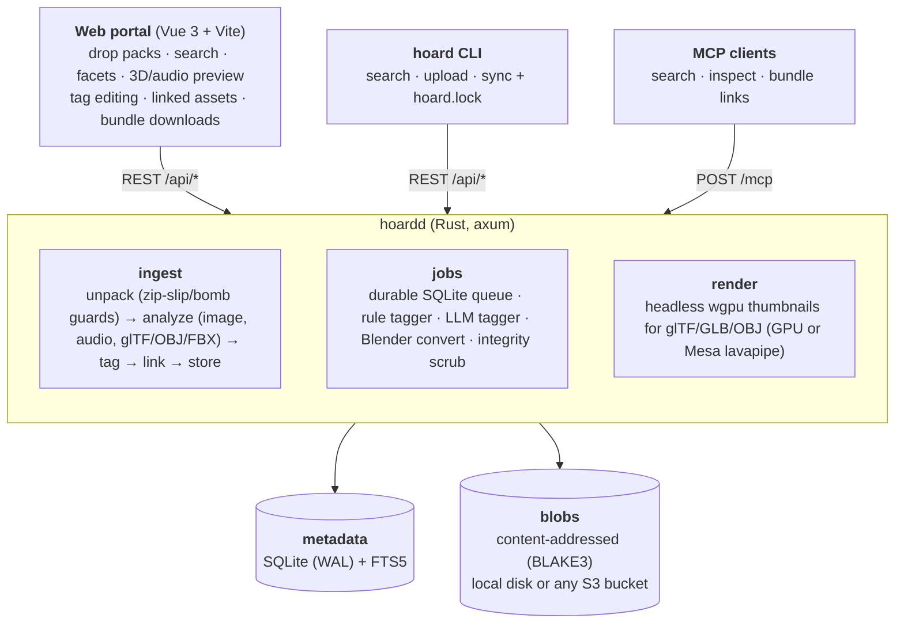

# Hoard

A self-hosted asset library for game development. Drop in whole asset packs (zips, tarballs, folders), and Hoard
stores every file once by its hash, works out what each file is, tags it, links meshes to their textures and
animations, and makes all of it searchable from a web portal, a CLI, an MCP endpoint for agents, and a lockfile-based
`hoard sync` that pulls exactly the files your game project needs.

Think of it as an asset store with no checkout.



## Install with Docker

Hoard ships as one image for amd64 and arm64: `ghcr.io/azazel-labs/hoard`. Save this as `compose.yml` (it's
[deploy/compose.yml](deploy/compose.yml)):

```yaml
services:
  hoard:
    container_name: hoard
    image: ghcr.io/azazel-labs/hoard:latest
    restart: unless-stopped
    environment:
      # Lets Hoard ask Watchtower (below) to update it as soon as it's idle after a release.
      HOARD_WATCHTOWER_URL: http://watchtower:8080
      HOARD_WATCHTOWER_TOKEN: hoard-update
    volumes:
      - hoard-config:/config      # database, Settings, backups: small, back it up
      - hoard-library:/library    # your files: big, put it on the disk with room
      - hoard-cache:/cache        # thumbnails, uploads in progress, Blender/ffmpeg: fast disk, can be rebuilt
    ports:
      - "4627:4627"
    labels:
      com.centurylinklabs.watchtower.enable: "true"
      com.centurylinklabs.watchtower.scope: hoard

  # Keeps Hoard up to date: pulls new images at 04:00 and restarts it.
  watchtower:
    container_name: hoard-watchtower
    image: ghcr.io/nicholas-fedor/watchtower:1.21
    restart: unless-stopped
    volumes:
      - /var/run/docker.sock:/var/run/docker.sock
    environment:
      WATCHTOWER_LABEL_ENABLE: "true"
      WATCHTOWER_SCOPE: hoard
      WATCHTOWER_CLEANUP: "true"
      WATCHTOWER_SCHEDULE: "0 0 4 * * *"
      # Hoard asks for its own update over this API once it's idle; the port isn't published, so only containers
      # in this file can reach it. Periodic polls keep the 04:00 check as well.
      WATCHTOWER_HTTP_API_ENDPOINTS: update
      WATCHTOWER_HTTP_API_TOKEN: hoard-update
      WATCHTOWER_HTTP_API_PERIODIC_POLLS: "true"
    labels:
      com.centurylinklabs.watchtower.scope: hoard

volumes:
  hoard-config:
  hoard-library:
  hoard-cache:
```

Each volume can be a folder on whichever disk suits it instead: `/mnt/big/hoard:/library` puts your files on the big
disk, while the database stays small and easy to back up. Folders you mount need no chown: Hoard takes over
`/config` and `/cache` and runs as whoever owns `/library` (set `PUID` and `PGID` to pick a user yourself).

Then start it:

```sh
docker compose up -d        # open http://<host>:4627
```

The first visit asks you to make an account, then opens a short setup that asks where your library lives. It suggests `/library`, the volume above; pick
it and drop a pack onto the portal. More locations come later, from **Settings → Library locations**:

- **A library Hoard keeps** gets copies of what you upload or import. Each one ticks the kinds of files it takes
  (audio on one disk, models on another), and one is the catch-all for the rest. Changing what a location takes
  applies to new files; **Move stored files to match** moves what's already stored. **Remove** moves a location's
  files to the others first, by kind, and removes it once it's empty. Each file is checked against its hash before
  the old copy is deleted. A location whose disk is gone can be removed anyway, and its files then show as missing.
- **A watched folder** is a folder of packs you already have. Each folder inside it becomes a pack, indexed where it
  sits. Hoard never changes, moves or deletes anything there. Mount it read-only if you like. Hoard looks through it
  at startup and every 15 minutes after (or when you press **Scan now**), picking up new folders, files added to or
  removed from a pack, and packs whose folder is gone. A folder that's suddenly empty or unreachable is taken for a
  disk that isn't mounted, and its packs are kept. A pack whose folder is missing is kept for three days, with its
  tags and notes, in case the folder comes back. Anything you delete for good from a watched pack stays deleted when
  the folder is rescanned, even though its files are still there.

A location is any folder the server can see, so in Docker, mount it into the container first.

**Updates are automatic.** Watchtower pulls each new release, and Hoard upgrades its database on start, saving a copy
in `/config/backups` first. Change the image tag to `:0.8` to get patch releases only, or delete the `watchtower`
service to update by hand (`docker compose pull && docker compose up -d`). The header shows a badge when a newer
release exists.

**GPU (optional).** Hoard renders 3D model thumbnails on the GPU when it can see one, and in software when it can't.
The packs page shows which (`GPU: ...` or `No GPU found`). To pass the GPU through, add the overlay for your
hardware:

```sh
# NVIDIA: needs the NVIDIA driver and the NVIDIA Container Toolkit on the host
docker compose -f compose.yml -f compose.gpu-nvidia.yml up -d

# Intel or AMD, including integrated graphics: needs /dev/dri on the host
echo "RENDER_GID=$(getent group render | cut -d: -f3)" >> .env
docker compose -f compose.yml -f compose.gpu-dri.yml up -d
```

Get both overlays from [deploy/](deploy/). They also put the local model server (AI tagging) on the GPU. Files on a NAS, S3 storage, remote access through Cloudflare
or Tailscale, and backups are covered in [docs/DEPLOYMENT.md](docs/DEPLOYMENT.md).

## Build from source

```sh
# Server (Rust 1.99.1 is pinned in rust-toolchain.toml; rustup installs it automatically)
cargo build --release
(cd web && npm ci && npm run build)
./target/release/hoardd                      # http://127.0.0.1:4627

# Try it with a generated sample pack (textures, PBR set, sprites, audio, glTF/OBJ/GLB models, CC0 license)
python3 tools/make_sample_pack.py /tmp/sample       # needs Pillow + numpy; ffmpeg optional
./target/release/hoard --token <token> upload /tmp/sample/forest-starter-kit.zip   # make the token in Settings → Account
```

Or drop the zip onto the portal.

### Development

Open the folder in VS Code and accept the recommended extensions (rust-analyzer, CodeLLDB, Vue, TOML, YAML).
Ctrl+Shift+B starts the dev servers; the Run and Debug panel has configurations for `hoardd`, `hoardd` with a local
model, unit tests, the CLI, `xtask`, the portal in the browser, and a "full stack" compound. Everything is also a
`cargo xtask` command, so the terminal and the editor do the same thing:

```sh
cargo xtask dev              # hoardd + Vite with hot reload on http://127.0.0.1:5173; Ctrl-C stops both
cargo xtask dev --llm        # ...plus a local model server for AI tagging (pick a model in Settings)
cargo xtask ci               # fmt, clippy -D warnings, tests, web build: what CI runs
cargo xtask sample --upload  # generate the sample pack and upload it
cargo xtask web              # build the portal into web/dist
```

Releases are automatic and change no files. Each push to `main` that passes CI is tagged with the next patch version
(`#minor` or `#major` in a commit message bumps that instead; `#skip-release` only refreshes the `:edge` image), and
the tag builds the binaries, the container image and the GitHub release. Builds take their version from the tag.

### Tests

`cargo test --workspace` runs the Rust tests. The portal has an end-to-end suite in [web/e2e/](web/e2e/) (Playwright,
Chromium): it starts its own `hoardd` on a free port with temporary data and library folders, makes the account and a
location, uploads packs it generates in code (PNGs, an OBJ with its material and texture, a glTF, JSON, text, a zip
and a 300-image pack), and drives the real portal: sign-in, the grid's infinite scroll and keyboard, the side panel,
the full-screen viewers, the packs finder, tag merging, collections, access tokens and copying, and phone-width and
dark-mode passes. It needs no network.

```sh
cargo build -p hoardd
cd web && npm ci && npm run build
npm run e2e:install          # once: Playwright's Chromium
npm run e2e                  # or: npx playwright test e2e/viewers.spec.ts --headed
```

It uses the newest `hoardd` under `target/` (debug, then release); `HOARD_BIN` points it at another, and
`HOARD_WEB_DIR` at another portal build. Failures keep a trace, a screenshot and the server's log in
`web/test-results/` (`npx playwright show-trace <trace.zip>`).

### Local models for the tagger

The AI tagger works with any OpenAI-compatible endpoint. The simplest is a local model server: every compose file in
[deploy/](deploy/) has an `llm` service (llama.cpp's server in router mode), and `cargo xtask llm` runs the same
thing on your machine. It starts with no model. In the portal, **Settings → AI tagging → Local model** lists these
vision models (they look at the contact sheets), all of which run on a laptop CPU, and downloads, switches and deletes
them with a click:

| Model | Hugging Face reference | Download | License | Notes |
|---|---|---|---|---|
| Qwen3.5 2B | `unsloth/Qwen3.5-2B-GGUF:Q4_K_M` | ~1.9 GB | Apache-2.0 | Good at the answer format; about 3 GB of RAM |
| Qwen3.5 4B | `unsloth/Qwen3.5-4B-GGUF:Q4_K_M` | ~3.4 GB | Apache-2.0 | Better names and descriptions; wants 6 GB of RAM |
| Qwen3-VL 2B | `Qwen/Qwen3-VL-2B-Instruct-GGUF:Q4_K_M` | ~1.9 GB | Apache-2.0 | Qwen's own GGUF build of the previous generation |
| Gemma 4 E2B | `unsloth/gemma-4-E2B-it-GGUF:Q4_K_M` | ~3.5 GB | Apache-2.0 | Google's edge model; strong captions |
| LFM2.5-VL 1.6B | `LiquidAI/LFM2.5-VL-1.6B-GGUF:Q4_0` | ~1.3 GB | LFM Open License 1.0 | Smallest and fastest; check the license for commercial use |

Any other GGUF model on Hugging Face can be downloaded the same way by its `owner/name:quant` reference; the vision
projector comes along with it. Thinking models run with reasoning off, since tagging wants a quick JSON answer.
`cargo xtask llm` needs llama.cpp (`curl -LsSf https://llama.app/install.sh | sh`, `brew install llama.cpp` or
`winget install llama.cpp`) and keeps models in `models/`. A hosted model (OpenAI, OpenRouter, …), your own Ollama,
or a ChatGPT plan through "Sign in with ChatGPT" is picked in the same place. `deploy/compose.yml` has ready-to-uncomment Ollama and vLLM services, and
[docs/DEPLOYMENT.md](docs/DEPLOYMENT.md#ai-tagging) compares them.

### Bulk imports

Imports of many gigabytes work from the browser and the CLI. "Import folder" in the portal (or dropping a folder)
uploads every file in it; a folder that looks like a folder *of* packs can be split into one pack per subfolder.
Uploads go through resumable sessions: the file list is registered first, small files travel in batches and big
ones in 32 MB chunks, and a dropped connection or closed tab picks up where it stopped (drop the same folder again).
The server fingerprints each import (paths and sizes), so re-running a bulk import skips packs it already has
("Import again anyway" or `hoard upload --force` overrides that).

```sh
hoard upload ~/Downloads/Humble-Bundle-2026/ --each    # one pack per subfolder or archive, resumable
```

Model thumbnails need a Vulkan/Metal/DX12/GL adapter. On a headless Linux box without a GPU, install Mesa's
software rasterizer (`apt install mesa-vulkan-drivers`). Without any adapter, everything else still works.

## What happens to a pack

1. **Unpack.** Archives are expanded server-side (zip, tar, tar.gz, and Unity's `.unitypackage`; nested ones too,
   3 levels deep), with `..`/absolute-path rejection and limits on expanded size and file count. A `.unitypackage`
   is rebuilt into its original `Assets/…` tree. `__MACOSX` and `.DS_Store` are dropped; Unity `.meta` files are read
   for their GUIDs (so materials and prefabs link to their textures) and then dropped, along with Godot `.import`
   files. Wrapper folders are collapsed and the innermost folder's name becomes the pack name.
2. **Store.** Each file's BLAKE3 hash is its name in blob storage, so a file shared by ten packs is stored once,
   corruption is detectable, and blobs never change (cache them forever, back them up with any sync tool).
3. **Analyze.**
   - Images: dimensions, alpha, a thumbnail, dominant color, seamless tiling on each axis (edge-continuity test),
     pixel-art detection (few colors, small, upscaled crisply), tangent-space normal map detection. Images over
     2048 px, and any format browsers can't draw (TGA, DDS, EXR, PSD…), also get a light preview of at most 2048 px
     (JPEG, or lossless WebP when there's transparency) for the image and 3D viewers.
   - GPU textures, decoded in pure Rust: DDS (BC1-7, raw RGBA/BGRA, float, legacy DXT and bitmask formats) and KTX2
     (BCn, ETC2/EAC, ASTC, raw, with zstd or zlib supercompression), with their GPU format and mip count. Basis
     Universal (KTX2 with BasisLZ/ETC1S or UASTC, and `.basis` files) is transcoded in pure Rust too. SVGs render
     with their text (system fonts, DejaVu in the Docker image), and Aseprite files show their first frame with
     frame, layer and animation-tag counts.
   - Fonts (TTF, OTF, TTC, WOFF, WOFF2): family and style (used as the name), designer, license, weight, italic, monospace,
     variable axes, glyph count and the writing systems covered, with an "Aa" specimen as the thumbnail. Symbol
     fonts show their first glyphs. Tagged `weight:bold`, `script:cyrillic`, `monospace`, `variable-font`, `icons`.
   - Audio: duration, sample rate, channels, embedded title/artist/genre, peak and RMS level (and clipping), plus a
     waveform thumbnail so a sharp hit and a sustained loop look different in the grid: mirrored bars with a solid
     core at the loudness and a halo to the peak, colored by how bright each moment sounds (azure bass, violet and
     orchid mids, orange hiss and cymbals). Formats Hoard doesn't decode
     itself (WMA, CAF, AAC/M4A, Opus, WavPack, APE, …) are decoded through ffmpeg (see below) for the same treatment.
   - Music: tracker modules (MOD, XM, S3M, IT) and MIDI are rendered to audio, so they get a waveform, a duration and
     an MP3 preview that plays in the grid like any other sound. Modules list their title, channels, patterns and
     instruments; MIDI lists tempo, tracks and General MIDI instruments. MIDI plays through a SoundFont
     (the one picked in Settings, or a GM SoundFont found in the usual system places), falling back to a simple built-in synth.
   - Metadata inside WAVs, as sound libraries ship it: BWF `bext` descriptions, `LIST/INFO` titles and keywords, iXML
     from Soundminer/BaseHead with Universal Category System (UCS) category, subcategory and CatID, `smpl` loop
     points, ACID tempo, root note and one-shot flag, cue markers, and RF64 for files over 4 GB. Embedded titles
     become the asset's name, and embedded descriptions show as "From the file".
   - Models: glTF/GLB mesh, material, animation and skin counts, vertex/triangle counts; OBJ counts; FBX version
     plus skin and animation detection; a wgpu-rendered thumbnail for glTF/GLB/OBJ/FBX, and for STL, PLY and
     MagicaVoxel `.vox`, which Hoard reads itself (voxels keep their palette colors). Thumbnails are drawn the way the
     3D viewer shows the model: textures from the file, an OBJ's MTL, or found in the pack by name; tone mapping;
     cut-outs and see-through surfaces; framed tightly from the same angle every time. Binary FBX geometry, node
     transforms, materials and embedded or nearby textures are read natively (axis and unit settings become glTF's
     Y-up meters); ASCII FBX needs Blender.
   - Unreal packages (`.uasset`, `.umap`), read without Unreal: see [Unreal packs](#unreal-packs).
   - Source files:
     - `.blend`: Blender version, compression, and the preview Blender embeds in every file (read directly, gzip
       or zstd, legacy and 5.0 headers, no Blender needed).
     - `.psd`/`.psb`: size, bit depth, color mode, layer count, and Photoshop's embedded preview.
     - `.kra`/`.ora`: the flattened image and layer count.
     - `.exr`/`.hdr`: tone-mapped previews.
     - Recognized by kind, without previews yet: GIMP, Clip Studio, Affinity, Procreate, Substance, ZBrush, Maya/Max,
       Houdini, C4D, DAW projects, and video.
4. **Tag (offline).** A deterministic tagger tokenizes paths (`FootstepGrass_01` → `footstep grass`), applies a
   game-asset vocabulary (audio-only words such as "run" only apply to audio), adds measured facts (`res:2k`, `pot`,
   `tileable`, `duration:short`, `poly:low`, `rigged`), groups PBR maps into sets (`Rock_Cliff_Normal.png` →
   `map:normal`, `set:rock-cliff`), detects the pack license from LICENSE/README files (`license:cc0`, `cc-by`, …),
   and picks a category from a fixed tree (`sfx/footsteps`, `textures/pbr`, `models/props`, …). Sounds get a UCS
   category (`ucs:footsteps`, `ucs:swooshes/swish`) from embedded metadata or confident rules, plus `loop`,
   `one-shot`, `bpm:120`, `root:a3`, `level:quiet`/`level:loud` and `clipped` where measured.
   - **Variants.** Numbered takes (`whoosh_01..12`, `Hit (3)`, `rock_v2`) in one folder form a family. The detail
     panel lists the other takes, and tag or category edits can apply to all of them at once.
   - **Duplicates.** Byte-identical files across packs (the same CC0 texture in five bundles) are stored once and
     listed under "Identical copies".
   - **Megascans files.** The `<id>.json` that comes with each Megascans asset names the pack (unless someone typed
     its name), adds its tags (`wood`, `furniture`, `color:brown`, …) to the pack and the asset, and gives the pack a
     short description: what it is, where it was scanned, its size and its maps. More → "Read the pack's files again"
     reads them again, for example after the description was deleted.
   - **Pack context.** README text is kept with the pack, and a store link inside it (Fab, itch.io, Humble Bundle,
     Unity Asset Store, Kenney, …) fills in where the pack came from. "Store details" on the packs page takes the
     store page URL, license tier and listing text. For a pack without a store link it first searches Fab, itch.io,
     Kenney and OpenGameArt and lists likely matches; "Use" fills in the form. Plain names ("Medieval Village" has
     dozens of listings) get help from the pack's files: the README's store links, seller ("Created by", "©") and
     product name ("Thank you for purchasing …"), product folders (`Content/<Product>`, `Assets/<Publisher>/<Product>`),
     the engine, and the mesh and texture counts, which are checked against Fab's technical details. A Megascans
     asset's `<id>.json` gives its exact listing title, which beats a file name like `…_Old_05_xeokah0_Raw`. Pieces of
     the name are searched too, and each match says which clues it fits. Whenever a pack has
     a store link and no text, from either place, Hoard fetches the page's title and description; the asset panel
     shows it as "From the <store> page".
   - **Store lookup.** New packs are looked up in the background, one every few seconds, newest first. When the pack
     names its listing itself (the README links to it, or the listing has exactly the title in its Megascans file),
     that listing becomes the pack's store page, with its seller and license. Store details says it was found
     automatically, and "Not this one" takes it off. Anything less certain is kept, so Store details lists the likely
     matches at once ("Search again" searches afresh). Turn it off in Settings → Server → "Look up store pages
     automatically".
5. **Link.** glTF buffers/images, OBJ → MTL → textures, FBX texture paths (absolute artist paths are matched by file
   name), DAE images, `.blend` external textures and linked libraries (`//` paths resolved relative to the file),
   `Model@Clip.fbx` animation clips, and name-based guesses for models that reference nothing. Game-engine and
   tool files link too: Unity materials, prefabs, scenes and controllers through their GUIDs; Tiled maps → tilesets
   → images; LDtk projects; BMFont `.fnt` → page images; Spine/libGDX `.atlas` → pages; TexturePacker JSON;
   Godot `.tres`/`.tscn` resources; and Unreal package imports.
6. **Tag (LLM, optional).** Any OpenAI-compatible endpoint (OpenAI, OpenRouter, Ollama, llama.cpp, vLLM, LM Studio),
   or a ChatGPT plan through "Sign in with ChatGPT", gets the pack context, paths, metadata and rule tags, and returns names, a description of one to three
   sentences (for music: mood, instruments, tempo and where it fits), extra tags, UCS subcategories and
   categories. Each variant family is sent once and the answer applies to every take. With
   thumbnails switched on in Settings, each batch also gets one numbered contact sheet of its thumbnails (one image instead of
   sixteen), and models appear as a 2x2 sheet rendered from four directions. It only adds; it never removes rule tags, never overrides anything a
   person edited, and can't flatten a specific category into a vaguer one.
   - **Descriptions.** Each kind is kept apart: a person's own (written in the asset panel or over MCP), the AI's,
     the file's embedded one and the pack's store page. Search covers all of them, and re-running the AI updates
     its description without touching yours.
7. **Convert (optional).** With Blender switched on (in Settings), .blend/.fbx/.dae/.usd/.ply/.stl/.3ds
   files are exported to GLB by headless Blender, with their linked textures laid out beside them. The GLB is stored as a derivative that feeds
   thumbnails, the browser preview and downloads.

Tags carry their source (`meta`, `rule`, `ai`, `human`). Human tags always win, and re-running the offline
tagger after improving the vocabulary (`POST /api/packs/{id}/retag`) replaces only `rule`/`meta` tags.

**Tidying tags.** Settings → Tags lists every tag with its count. Pick tags that mean the same thing and merge
them, or pick one to rename it (a rename that leaves off the prefix keeps it, so renaming `set:rock-000` to
"granite" gives `set:granite`). The old names are remembered: when a tagger comes up with one later, the asset gets
the new name instead. "Allow the old name again" undoes that.

**Renaming packs.** More → Rename on the packs page. Filters, links and collections refer to a pack by its id and
rescans match it by its folder, so only the name you see changes.

**Finding packs.** The packs page searches names, stores, licenses, descriptions and tags (every word has to
match), filters by what a pack holds, its status and its store, and sorts by date, name, size or asset count.

### Materials from texture maps

Texture maps that share a name in one folder become a material: `Rock_BaseColor.png`, `Rock_Normal.png` and
`Rock_Roughness.png` are one "Rock" tile in the grid, with a lit sphere as its thumbnail. Hoard reads the naming of
Megascans, Poly Haven, ambientCG, Substance and Unreal (`T_Rock_N`), and knows base colour, normal (OpenGL or
DirectX), roughness, gloss, metalness, ambient occlusion, height, bump, cavity, specular, opacity, emissive and packed
maps (ORM, ARM, MRA, RMA). The same set in several sizes (`Rock_2K_…`, `Rock_4K_…`, or `2K/` and `4K/` folders) is
one material. It takes a colour map plus one more, or two other kinds of map.

- **In the grid**, a material searches, filters, tags and collects like any asset. Its maps are hidden; "Show" next
  to "supporting files hidden" brings them back.
- **In the detail panel**, the material turns in a live preview, with its maps listed by kind and size. Click one to
  open it. Double-click the tile (or the preview) for the full-screen viewer: sphere, cube or plane, how often it
  repeats, how far the height map pushes, each map switched off and on, the environment light and the background.
- **Models** that use a material's maps, by naming them or by sharing its name (`Rock_A.fbx` next to the `Rock_…`
  maps), show the material in their panel. On a model that names no textures, the 3D viewers put its maps on by kind.
  A material only one model wears (or only that model's LODs, `Rock_LOD0` … `Rock_LOD3`) is part of it: it leaves the
  grid like its maps and opens from the model's panel. A material several models share stays a tile of its own.
- **Downloading** a material gives a zip of all its maps. A model that uses one brings the maps along.

New packs are looked through as they come in, and packs already in the library once after an upgrade. A rescan or
"Re-run offline tagger" (packs page, More) looks again.

**Model thumbnails from the browser.** The 3D viewer sometimes finds textures the server's renderer can't. When you're
signed in and open a model, once it's shown with its textures, the viewer's picture (same angle and framing as the
server's) becomes the asset's thumbnail. A picture with every texture is never replaced by one with some missing,
and neither is replaced by the server's, including when the pack is re-analyzed. For a whole pack, More → Make
thumbnails in this browser opens each model out of sight, one at a time, with progress and Cancel.

**Big textures.** The image viewer opens a big texture as its light preview and shows both sizes (pixels and bytes).
Zooming in past the preview's pixels, Full resolution or F loads the file itself. The 3D viewers load light previews
of textures too; the full-screen viewer's Full-res switch (H) loads every texture file as it is. The detail panel
shows the size of each linked file and of each download.

## Getting assets into an engine

**Bundles.** Every asset with links has a "Download with N linked files (.zip)" button, built on the fly, that keeps
the original relative layout. Unzip it and `crate.gltf` still finds `crate.bin` and `textures/crate_albedo.png`.
Whole packs download as one zip too, and so does any selection: Ctrl/Cmd-click, Shift-click or press X on tiles
(long-press on a phone), then "Download zip" gets them all with their dependencies, one folder per pack. Zips are
streamed as they're written, so even a multi-gigabyte pack starts downloading at once.

**Download as.** The detail panel's "Download as" converts on request (the first download makes and caches it, so
later ones are instant). Cached conversions are kept up to a limit (Settings → Server → Converted downloads, 10 GB
unless you change it); past that, the least recently downloaded go first, never one handed out in the last hour. Images, models, fonts, WAV/FLAC and music rendering are Hoard's own code; MP3, OGG Vorbis
and Opus use ffmpeg's reference encoders (LAME, libvorbis, libopus), as do sources only ffmpeg reads:

| From | To |
|---|---|
| PNG, JPEG, WebP, TGA, TIFF, BMP, GIF, EXR, HDR, PSD/PSB (full composite), Krita, OpenRaster, DDS, KTX2, SVG, Aseprite | PNG, JPEG, WebP (lossless), TGA, TIFF, plus EXR for HDR sources; optionally scaled down to 4096…64 px, including in the original format |
| WAV, FLAC, OGG Vorbis, MP3, AIFF, and with ffmpeg also AAC/M4A, Opus, WMA, CAF, WavPack, APE, MKA | WAV (16 or 24-bit, as the source), FLAC, MP3 (VBR ~190 kbps), OGG Vorbis (q5), Opus (128 kbps) |
| MOD, XM, S3M, IT, MIDI | the same audio formats, rendered |
| glTF | GLB (buffers and textures packed in) |
| GLB | glTF + .bin (zipped) |
| OBJ (with MTL and textures), binary FBX, STL, PLY, MagicaVoxel | GLB with textures embedded |
| TTF/OTF | WOFF2, WOFF |
| WOFF, WOFF2 | TTF/OTF and each other |
| anything else Blender converted (Settings → Blender) | GLB |

`GET /api/assets/{id}/as/{format}[?max=1024]`; the asset detail lists the formats on offer. 16-bit images stay
16-bit; HDR going into an 8-bit format is tone-mapped rather than clipped.

Conversions never hold up the server. They run detached, at most two at a time: a request waits up to `?wait=`
seconds (default 20) and then gets `202` with `{"state": "converting", "progress": 0.4}` and `Retry-After`, while
the conversion carries on even if the client leaves. Requests for the same conversion share it.
`GET /api/assets/{id}/as/{format}/status` starts or checks one without downloading (the portal shows its progress
on the button).

**ffmpeg** is fetched by the server itself: set to Automatic in Settings (the default) Hoard uses a system ffmpeg that
has LAME, libvorbis and libopus, or else downloads a static build in the background into `<data dir>/tools/ffmpeg`
(Martin Riedl's builds for Linux and macOS, BtbN's for Windows), checks it against the publisher's SHA-256, and uses
it from then on. Pick a specific binary there, or turn it off. Until it's ready, or without it
(offline), MP3 and Opus use built-in pure-Rust encoders, and OGG and ffmpeg-only sources aren't offered. ffmpeg only
ever reads uploads with their format forced (no playlists or concat scripts), local files only, under a time
limit. The packs page shows its state.

**Activity.** The pulse icon in the portal's header counts what's running in the background; hover or click it for
the list (ingests with file counts, tagging, conversions, zips being streamed, the ffmpeg download), with progress
and the queued jobs behind them. `GET /api/activity` returns the same.

The portal has light, dark and "match system" themes (the switch beside it), remembered per browser.

**Responsiveness.** Analysis, conversion, rendering, zipping, ffmpeg and Blender run on their own threads at a
lower CPU priority than request handling (Linux `nice` 10, inherited by child processes), so the portal and API stay
quick while a pack ingests on every core.

**Unity.** Bundles of assets that came from a `.unitypackage` (or a Unity project folder) include a minimal `.meta`
for each file with its original GUID, so materials and prefabs still find their textures when you drop the folder
into a Unity project.

**Browsing.** Sounds play straight from the grid (the play button, or Space), with the played part shaded over the
waveform. Arrow keys move through results, Enter opens one, and with the detail panel open the arrows step through
assets for quick triage. Searches and filters live in the URL, so a search can be bookmarked or shared. Files that
only exist to support a model (glTF buffers, `.mtl` libraries) are hidden from the grid by default; they still come
along in downloads.

**`hoard sync`.** A package manager for art. In your game project:

```sh
hoard init        # writes hoard.toml
hoard sync        # downloads, verifies BLAKE3, writes hoard.lock; run again and it downloads nothing
```

```toml
server = "http://nas.local:4627"
out_dir = "assets/hoard"        # Godot: a folder under res://, Unity: Assets/Hoard, Bevy: assets/hoard
layout = "category"             # category | pack | flat
sidecars = true                 # <file>.hoard.json with tags, category, provenance for import scripts
prune = true                    # delete files a previous sync added that nothing selects anymore

[[select]]
query = "footstep"
kind = "audio"
dest = "sfx/footsteps"

[[select]]
tags = ["pbr"]
kind = "texture"

[[select]]
ids = ["0192f0c4-…"]            # pin one model; its textures come along (with_deps = true by default)
with_animations = true
```

Models with dependencies land in their own folder (`models/props/crate/crate.gltf`, `…/crate/textures/…`), so
relative references survive any layout. Commit `hoard.toml` and `hoard.lock`, and teammates get identical,
hash-verified files.

**Manifest API.** Engine plugins can call `POST /api/manifest` with ids and/or a search, plus
`include_deps`, and get a flat list of hashes, sizes, tags, suggested paths and immutable `/api/blobs/{hash}` URLs.

## Unreal packs

Fab and Unreal Marketplace packs often arrive as Unreal content (`Content/<Pack>/…/*.uasset`) rather than FBX, PNG
and WAV. Hoard reads editor packages from UE 4.x through 5.7 directly, without Unreal installed:

- **What it is:** the asset's class (`StaticMesh`, `Texture2D`, `SoundWave`, `MaterialInstanceConstant`, …) sets
  its kind, so a mesh files under models and a sound under audio. Tagged `unreal`, `ue:static-mesh`,
  `engine:ue5.3`.
- **Preview:** the thumbnail the editor saved for its Content Browser (PNG in UE4, JPEG in UE5).
- **Facts:** the asset registry tags the editor writes (texture dimensions, triangle and vertex counts, durations,
  material domains, …), shown in the detail panel and used for the usual tags (`poly:low`, `res:2k`).
- **Links:** each package's imports (`/Game/Pack/Materials/MI_Rock`) are resolved to the pack's own files, so a
  mesh links to its material instance and that to its textures, and a bundle download pulls them all.
- **Names:** naming-convention prefixes are dropped (`SM_TreeStump` → "Tree stump", `T_Rock_N` → "Rock normal").
- **Source files, where Unreal kept them:** a `SoundWave` stores the WAV it was imported from, and UE4-era
  textures keep their source as PNG. Hoard pulls those out: the sound gets a real waveform and plays in the grid,
  the texture gets analyzed like any PNG, and "Download .wav/.png" (or "Recovered WAV/PNG instead of .uasset" on a
  selection zip) gives you the original file.

### Converting to common formats

Hoard can take the content out of the packages and keep it as ordinary files, so a Fab pack ends up as PNGs, WAVs
and FBX like any other pack. It runs after every ingest (Settings → Unreal packages, default keep the originals) or on demand from
the pack page (More → Convert Unreal content) and `POST /api/packs/{id}/unreal/convert`.

| Package | Becomes | Done by |
|---|---|---|
| `Texture2D` imported from PNG/JPEG | that PNG/JPEG, byte for byte | Hoard |
| `Texture2D` imported uncompressed (TGA, PSD, EXR…) | PNG (8/16-bit) or EXR (HDR) when the pixels are stored plain or LZ4; FBX/PNG/EXR export when Oodle | Hoard, or Unreal Editor |
| `SoundWave` | the imported WAV, byte for byte | Hoard |
| `Material`, `MaterialInstanceConstant` | `material.json`: parent, texture/scalar/vector parameters, PBR slot guesses | Hoard |
| `DataTable` | JSON rows | Hoard |
| `StaticMesh`, `SkeletalMesh`, animations | FBX | Unreal Editor, via `hoard unreal-worker` |
| Blueprints, levels, … | stays a package (nothing to convert it to) | – |

Hoard's reader (`crates/hoard-unreal`) is its own safe Rust, no engine libraries: package summary, tagged
properties (UE 4.x, 5.0-5.3 and 5.4+ layouts), UE4 bulk data and the UE5 package trailer with uncompressed and LZ4
payloads. UE5 compresses raw source data with Oodle by default, which only Unreal decodes, so textures imported
from uncompressed formats usually go to the editor worker. Sources that were compressed when imported (PNG, JPEG)
don't shrink, so Unreal stores them as they are, and Hoard converts those itself.

The converted file takes over the asset: same id, tags, links, collections and family. `GET /api/assets/{id}`
gains an `origin` (original path, class, engine, how it was converted), the Unreal tags stay, and other packages'
references keep resolving to it. With `keep` the original `.uasset` stays downloadable
(`GET /api/assets/{id}/original`); with `replace`, or "Discard the original .uasset files" in the portal, it's
deleted once its content is out. Unreal-only data (material graphs, Blueprint logic) goes with it.

**Meshes and animations** need Unreal itself. Run the worker on any machine with Unreal Editor installed:

```sh
hoard --server https://hoard.example.com unreal-worker --editor "C:/Program Files/Epic Games/UE_5.4/Engine/Binaries/Win64/UnrealEditor-Cmd.exe"
```

It polls `GET /api/unreal/pending`, lays each pack out as a throwaway project with every package at its
`/Game/...` path (inferring the mount when an upload lost the `Content/` folder), runs the bundled export script
headless, uploads the FBX files (`POST /api/assets/{id}/replace`) and has the server re-analyze the pack.
`--once` works through the queue and exits, `--keep-originals` keeps the packages, and `--dry-run` shows the
layout without starting the editor. `cargo xtask unreal-export <pack>/Content --editor …` still exports a local
Content folder directly. Cooked packages from shipped games are recognized but carry no editor data to convert.

Check the license before moving content between engines: Fab's Standard License allows use in other engines and
tools, but some Epic-made content is licensed for Unreal Engine only.

## Collections

A collection is a hand-picked set of assets from any packs, like everything chosen for one level. Select tiles
and use "Add to collection" (typing a new name creates one), or add from an asset's detail panel. Collections sit
at the top of the filter sidebar and on the packs page, download as one zip with their dependencies, and work in
`hoard.toml`:

```toml
[[select]]
collection = "Forest level"
dest = "levels/forest"
```

## Search by colour, by what pictures show, and More like this

Hoard looks at the thumbnail of every texture, model, material, animation, video and sprite, and works out its main
colours and what its surface looks like. A background job does this for new packs and, once, for everything already
in the library. Activity shows it as "Working out colours and looks".

- **Colour.** The Colour swatches in the filter sidebar (or the picker beside them, for any colour) show assets with
  much of that colour, the ones it covers most first. A slightly different shade still counts, because colours are
  compared the way eyes see them (in OKLab). Colour works together with words, kind, tags, pack and collection. An
  asset's detail panel shows its colours as a strip sized by how much of the picture each covers. Click one to search
  the whole library for it.
- **More like this.** The button in the detail panel, or the overlapping squares on a tile's corner, shows assets that
  look like this one, across every pack, most alike first. You might get other rocks for a rock texture, the same
  texture at another size, or renders of similar models. The results are an ordinary search, so you can scroll, select
  and narrow them by kind, tags or words. "Newest" in the sort menu sets the ranking aside.

What counts as alike is the colours (a colour histogram), the grain and edges of the surface (edge directions,
contrast and local binary patterns, measured in a way that ignores which way a texture is turned), and a perceptual
hash that catches near-copies. It is all computed on the server from the thumbnail, needs no model download and works
offline. On its own, nothing in it knows what a picture shows. Two brown, rough textures can count as alike even when
one is bark and the other is rock. Fonts, audio, documents and shaders take no part.

### Image search

Settings → Image search adds a model that does know what pictures show (OpenAI's CLIP, ViT-B/32). It's off until an
admin turns it on, because the model is a 605 MB download (from Hugging Face, pinned to one revision and checked
against its SHA-256, into the cache folder's `models`). It runs on the server's processor, and nothing leaves the
server. A background job, "Learning what pictures show", then works through every thumbnail at low priority, at
roughly 5–10 pictures a second, and keeps up with new packs. Settings shows how far it has got.

- **Words.** The main search box finds pictures that show what you typed ("mossy rock", "brick wall", "ceiling
  lamp") beside the assets whose names, tags or descriptions have the words. A name match still ranks above a weak
  picture match. Words with nothing to show return only the name matches.
- **More like this** weighs what the pictures show above their colours and grain, so a barrel brings up barrels
  rather than anything brown.

The model takes 300–600 MB of memory while it works: the picture half during the job, the words half from the first
search until 15 minutes after the last. Turning image search off deletes the model and keeps what it learned, so
turning it back on only downloads the model again.

## Credits

Hoard writes a `CREDITS.md` for whatever you ship: one row per pack with its seller, store page, license and
whether the license asks for credit, then the credit lines to paste into your game's credits and any terms worth
knowing ("Non-commercial use only."). The license comes from the pack's own license file, then the license on its
store page, then the store itself (a Fab pack without one is under Fab's Standard License). Each pack says
**Required**, **Not required**, **Keep the license notice** (MIT, GPL, OFL) or **Not known**. Nothing is guessed:
when Hoard doesn't know a license, the file says how many packs to check by hand.

- **Packs page:** More → Download credits on a pack, and Credits on a collection.
- **A selection:** select tiles, then Credits next to "Download zip". It covers the packs of everything selected
  and what it needs.
- **Zips:** every pack, collection and selection zip has `CREDITS.md` at its root.
- **Your game project:** `hoard credits` covers what `hoard.toml` selects (`--pack` and `--collection` name others
  instead, `--json` for JSON, `--out CREDITS.md` to write a file).
- **Agents:** the `get_credits` MCP tool.

## MCP for agents

`POST /mcp` is a stateless Streamable HTTP MCP endpoint. It speaks both the 2026-07-28 protocol (per-request `_meta`,
`server/discover`) and the older `initialize` handshake (2025-11-25 back to 2025-03-26), so current and older clients
both connect.

| Tool | What it does |
|---|---|
| `search_assets` | full-text + kind/tag/pack filters, with thumbnail and download URLs; `include_previews` returns the first 8 thumbnails as images |
| `find_similar` | assets that look like a given one (colours, surface, near-copies), across every pack; same result shape as `search_assets` |
| `find_by_color` | assets with much of a hex colour in them, most of it first |
| `get_asset` | full detail: metadata, tags with sources, links, what uses it, variants, identical copies, the thumbnail's colours |
| `get_bundle` | download URLs and save-as paths for an asset and everything it needs, plus a zip URL |
| `list_packs`, `list_tags`, `list_collections` | browse the library, its tag vocabulary and collections (`search_assets` takes `collection` too) |
| `get_credits` | who made the packs behind some packs, collections, assets or a search, their licenses and the credit lines they ask for (`markdown` for a ready `CREDITS.md`) |
| `tag_asset`, `update_asset` | edits, recorded as human |
| `next_to_tag` | the next files nothing has described yet (up to 16, one pack at a time), with facts, the pack's store page and README, and a numbered contact sheet image |
| `save_tags` | names, categories, descriptions and tags for a batch (and the pack), recorded as AI-made exactly like Hoard's own AI tagger: a person's edits always win |

The `tag_pack` prompt (in Claude Code: `/mcp__hoard__tag_pack <pack name>`) tells the agent to loop `next_to_tag` →
look → `save_tags` until the pack is done, with the same naming, category and tag rules Hoard's built-in tagger uses.

**Connecting Claude.** Settings → Account → *Claude and other AI apps* has the address and the steps. Apps sign in to
Hoard over OAuth the first time (Hoard opens in your browser and asks you to allow it), and Settings → Account lists
them and disconnects them.

- **Claude Code:** `claude mcp add --transport http --scope user hoard https://your-host/mcp`, then `/mcp` to sign in.
- **claude.ai, Claude Desktop and Cowork:** Settings → Connectors → Add custom connector, paste
  `https://your-host/mcp`, then Connect. These connect from Anthropic's servers, so Hoard has to be reachable from the
  internet over HTTPS with a certificate browsers trust (Settings → HTTPS with your own certificate, or a reverse
  proxy, Tailscale Funnel or a Cloudflare tunnel), and its Public address (Settings → Server) set to that URL.

**Tagging with your Claude subscription.** Hoard can't sign in to Claude for you (Anthropic doesn't allow other apps to
use a Claude login), but Claude can come to Hoard: connect it and run `/mcp__hoard__tag_pack Medieval Village` (or ask
"tag the untagged packs in Hoard"). It looks at each contact sheet and saves its descriptions, on your plan.

Other MCP clients can sign in the same way (OAuth 2.1 with PKCE and dynamic client registration; the 401 from `/mcp`
points at `/.well-known/oauth-protected-resource/mcp`), or send an access token from Settings → Account as
`Authorization: Bearer <token>`. `/mcp` always needs one or the other, even with guest browsing on: asking is what makes
apps offer to sign in. Browser-originated requests from other origins are rejected (DNS-rebinding guard). Set the public
address in Settings → Server so returned links are absolute.

## Storage, and splitting it from the web server

Each library location Hoard keeps is a folder, or an S3-compatible bucket: give the location's folder as
`s3://<bucket>` and set the `HOARD_S3_*` variables for the endpoint and keys. The bucket can be Garage, RustFS, SeaweedFS or VersityGW on a NAS, or R2/B2/AWS. Downloads are streamed through the server with HTTP
Range support (audio and video seek), and immutable caching headers let a CDN absorb repeat traffic.
`HOARD_S3_HEADERS` adds headers to every storage request, e.g. Cloudflare Access service-token headers when the NAS's
S3 endpoint sits behind Access.

[docs/DEPLOYMENT.md](docs/DEPLOYMENT.md) covers the setups. The recommended one is everything on the NAS, reachable
from anywhere only through Cloudflare One private routing (or Tailscale), with no public hostname
(`deploy/compose.private.yml`). It also covers a public hostname via Cloudflare Tunnel, web on a VPS with blobs on the
NAS, and a Cloudflare-native plan.

## HTTPS, HTTP/2 and HTTP/3

A library page loads hundreds of thumbnails, so connection reuse matters. Over plain HTTP, `hoardd` speaks HTTP/1.1
and cleartext HTTP/2 (h2c), but browsers only use HTTP/2 over HTTPS, where the whole grid shares one multiplexed
connection. Browsers also keep some things for HTTPS pages: 3D with WebGPU, the modern clipboard, installing Hoard as
an app, and Claude connectors. When the portal is opened over plain `http://` from another device, a dismissible line
under the header says so and links to the setup.

**Settings → HTTPS** turns it on. HTTPS is served on the same port as `http://` (4627 unless `--listen` says
otherwise): Hoard tells the two apart by the first byte a client sends. So there's no extra port to open, and a change
applies at once, without a restart. Choose one of:

- **Hoard's own certificate.** Hoard makes a certificate authority once (kept in the data folder, under `tls/`) and
  issues the server's certificate from it, for the addresses it finds (this computer's name and LAN addresses, the
  public address from Settings → Server) and any you add. The address you're using is added for you, which matters in
  Docker, where Hoard can't see the host's addresses. Download `hoard-ca.crt` from the same page and install it once on
  each device (the page has the steps for Windows, macOS, iPhone and iPad, Android, Linux and Firefox); its browsers
  then trust Hoard, now and after every renewal. The server certificate is renewed and re-issued by itself. Give the
  `hoard` CLI the same file with `--ca-cert hoard-ca.crt`.
- **My certificate.** Paste or upload a PEM certificate chain and its private key. Hoard checks that the key belongs to
  the certificate and that it's in date, and shows the names it covers and when it runs out. On a tailnet with HTTPS
  turned on, `tailscale cert <machine>.<tailnet>.ts.net` gives you one browsers trust (for 90 days, so upload the new
  one before then); for a domain you own, use any ACME client (certbot, acme.sh, lego) and upload `fullchain.pem` and
  `privkey.pem`.
- **Off.** Plain `http://` only. The right choice behind a reverse proxy (Caddy, Traefik, nginx, Cloudflare Tunnel,
  Tailscale Serve or Funnel) that has the certificate: let it send plain `http://` to Hoard. Hoard reads
  `X-Forwarded-Proto` from it, so sign-in cookies and MCP links still say `https`.

Hoard tries a new certificate in a test connection before switching to it, and keeps what it had if that fails.

**Plain `http://` once HTTPS is on.** It keeps working on the same port. Browsers on other devices that load a page
over `http://` are sent to `https://` (a temporary redirect, and Hoard never sends HSTS, so turning HTTPS off again
just works); a switch on the page turns that off. Everything else is served as before: the `hoard` CLI, the Unreal
worker, scripts, MCP apps, anything going through a reverse proxy, and `http://localhost` on the server itself. If a
certificate ever locks you out, open `http://localhost:4627` on the server, or run `hoardd --https-off` (in Docker:
`docker compose exec hoard hoardd --https-off`) and restart Hoard.

**HTTP/3** (a switch on the same page) adds QUIC on the same port number over UDP, advertised with `Alt-Svc`, so
browsers move to it after the first page load. Open UDP 4627 as well as TCP (the compose files map both). Browsers only
use HTTP/3 with a certificate they trust.

Responses are compressed with Brotli/zstd/gzip where it helps (not for images, audio, models or zips), the built
portal's hashed assets are cached as immutable, and blob downloads carry ETags and Range support.

## Configuration

Where the server keeps things, how it listens and how it's protected are set when it starts, with a flag or env var
(`hoardd --help` lists them). Everything else (AI tagging, Blender, ffmpeg, Unreal conversion, thumbnails, the
update check, workers, limits, the public address, HTTPS, the SoundFont) is changed in **Settings** in the portal header
(behind the write token), takes effect at once, and is kept in the database, so it survives restarts and backups.

Set before starting (these need a restart):

| Env | Default | |
|---|---|---|
| `HOARD_LISTEN` | `127.0.0.1:4627` | bind address |
| `HOARD_DATA_DIR` | `./hoard-data` | the database (with Settings), its backups, the HTTPS certificates |
| `HOARD_FILES_DIR` | – | the folder the first-run setup suggests (`/library` in the image) |
| `HOARD_CACHE_DIR` | `<data dir>` | thumbnails and previews, uploads in progress, scratch space, downloaded Blender/ffmpeg |
| `HOARD_WEB_DIR` | `./web/dist` | built portal |
| `HOARD_WATCHTOWER_URL` / `_TOKEN` / `_CONTAINER` | – / – / `hoard` | Watchtower's HTTP API: Hoard asks it to update this container once a release is out and Hoard is idle |
| `HOARD_LOCAL_LLM_URL` | `http://llm:8080/v1` | where the local model server listens (Settings → AI tagging → Local model) |
| `HOARD_S3_ENDPOINT` / `_BUCKET` / `_REGION` / `_ACCESS_KEY` / `_SECRET_KEY` / `_HEADERS` | – | the S3 service for `s3://` library locations |

## Keeping it safe

**Settings → Maintenance** has a button for each job that looks after the library, with progress while it runs and a history of past runs:
back up the database, check files for damage, re-analyze every pack (thumbnails, previews and rule tags made afresh;
your edits stay, the AI isn't asked again), shrink thumbnails, clear cached "Download as" conversions and leftovers,
and delete unused files. One of each runs at a time. Backup, scrub and gc can also be run from cron (below) and show up in the
history the same way.

**Settings → Issues** lists what went wrong opening or processing files, most serious first: packs that failed to
ingest, damaged or missing files, watched folders that can't be read or have vanished (an unmounted drive), jobs that
gave up, archives that wouldn't unpack, files that couldn't be opened or made sense of, models the thumbnail renderer
failed on, failed conversions and Unreal packages, material detection and store files that couldn't be read. Each
links to its pack or file, and says how often it happened and when. Fix the cause, then try it again from there
(scan the folder again, re-analyze the pack, retry the job), one at a time or a whole kind at once, or dismiss it.
An issue that's fixed by the next scan or analysis goes away on its own. `GET /api/admin/issues` has the same list.

**Thumbnails.** Settings → Server → Thumbnails picks how thumbnails and model views are stored: Smaller, Balanced
(the default) or Sharper JPEG, or Lossless PNG. Anything with transparency (model renders, waveforms, font
specimens, cut-out sprites) and pixel art always stays PNG, and so does a picture whose PNG is about as small as the
JPEG would be. For photo-like textures Balanced is roughly an eighth of the PNG. Changing it affects new thumbnails;
Maintenance → Shrink thumbnails re-stores the existing PNG ones.

- Content addressing: every byte is verifiable. `POST /api/admin/scrub` re-hashes all blobs (local or S3) and flags
  corrupt or missing ones; the portal shows the count. It answers 202 and runs in the background.
- Write-once blobs (read-only on disk), fsync before rename on local storage.
- `POST /api/admin/backup` writes a consistent SQLite snapshot (`VACUUM INTO`) to `backups/` next to the database
  and answers `{"summary": "Saved <path> (<size>)"}`. Back up that file plus the blob store; blobs never change, so
  incremental sync is trivial.
- `POST /api/admin/gc` deletes blobs no asset, thumbnail, derivative or kept original references (after deleting
  packs).
- Uploads: path traversal rejected, archive expansion capped, symlinks in tarballs ignored.

## Accounts and access tokens

The first visit to a new server makes its first account. Add accounts for other people, change your password, and
make access tokens in **Settings → Account**. Every account can do everything, including managing accounts.

- **Signing in** gives the browser a session cookie (HttpOnly, SameSite=Lax) that lasts until you sign out or don't
  visit for 30 days. Repeated wrong passwords for a name are slowed down.
- **Access tokens** are for everything that isn't a browser: the `hoard` CLI (`--token` or `HOARD_TOKEN`), scripts and
  cron, MCP clients and the Unreal worker. They're sent as `Authorization: Bearer <token>`, shown once when made, and
  can be revoked; the list shows when each was last used. A token can do everything except manage accounts and tokens.
- **Connected apps** (Claude, other MCP clients) sign in over OAuth: you allow each one in the browser, it acts as
  you with an access token's powers, and Settings → Account disconnects it.
- **Guest browsing** (off by default) lets anyone who can reach the server search, preview and download without
  signing in. Changing anything still needs an account or a token.
- **Forgot your password?** On the server, `hoardd --reset-password <name>` prints a new one and signs that account out
  everywhere. In Docker: `docker compose exec hoard hoardd --reset-password <name>`.

From cron, with a token made for it:

```sh
curl -fsS -X POST -H "Authorization: Bearer $HOARD_TOKEN" http://localhost:4627/api/admin/backup
```

## API overview

Every request needs a signed-in session or `Authorization: Bearer <token>`, except reads while guest browsing is on.
Requests that change something are marked 🔒: guests can't make them. A browser session's changes must also carry an
`X-Hoard` header, which pages on other sites can't add.

**Assets**

| Method | Path | |
|---|---|---|
| GET | `/api/assets` | search: `q`, `kind`, `tags=a,b`, `pack`, `collection`, `ext`, `similar=<asset id>`, `color=<hex>`, `sort`, `limit`, `offset`, `hide_supporting`; results plus kind/tag facets |
| GET | `/api/assets/{id}` | one asset, with tags, metadata and dependencies |
| PATCH 🔒 | `/api/assets/{id}` | rename, recategorize, describe, tag; `apply_to_family` for a whole variant family |
| GET | `/api/assets/{id}/file` | the file (`?download=1` to save it) |
| GET | `/api/assets/{id}/thumb` | thumbnail (`?v=` its `thumb_rev`, for a URL that's cached for good) |
| PUT 🔒 | `/api/assets/{id}/thumb` | a model's thumbnail drawn by a browser (PNG/JPEG/WebP body, `?source=browser` or `browser-partial`); kept only if it's no worse than the one there |
| GET | `/api/assets/{id}/lite` | a texture's light preview (at most 2048 px), made on first request if it has none |
| GET | `/api/assets/{id}/original` | the file as it came in, when it was converted on ingest |
| GET | `/api/assets/{id}/derivative/{kind}` | `glb`, `views`, or `source` (a recovered WAV/PNG) |
| GET | `/api/assets/{id}/as/{format}` | download converted (`?max=` size, `?wait=` seconds); `/status` to follow a slow one |
| GET | `/api/assets/{id}/bundle.zip` | the asset and everything it needs (`?animations=1`) |
| POST 🔒 | `/api/assets/{id}/replace?ext=` | swap in a new file (body is the file) |
| GET | `/api/bundle.zip?ids=a,b,c` | a selection as one zip (`&deps=0`, `&sources=1`) |
| POST | `/api/manifest` | a flat file list (hash, path, URL) for `ids` or a search, with `include_deps`; what engine tools pull from |
| POST | `/api/credits` | credits for `packs` (ids or names), `collections`, asset `ids` and `selections` (manifest requests); `?format=md` for `CREDITS.md` |
| GET | `/api/blobs/{hash}` | raw content by BLAKE3 hash |
| GET | `/api/tags?prefix=` | tag autocomplete (`anywhere=true` matches inside names, for Settings → Tags) |
| POST 🔒 | `/api/tags/merge` | `{from: [...], into}`: retag those assets and remember the old names |
| GET, DELETE 🔒 | `/api/tags/aliases` | merged-away names; `DELETE ?tag=` allows one again |

**Packs**

| Method | Path | |
|---|---|---|
| GET | `/api/packs` | all packs |
| POST 🔒 | `/api/packs` | upload a pack in one request (multipart) |
| GET | `/api/packs/{id}` | one pack and its status |
| PATCH 🔒 | `/api/packs/{id}` | rename it (`{name}`) |
| DELETE 🔒 | `/api/packs/{id}` | delete it (blobs go at the next `gc`) |
| POST 🔒 | `/api/packs/{id}/retag` | run the tagger again |
| POST 🔒 | `/api/packs/{id}/read-files` | read the pack's Megascans files again (name, tags, description) |
| GET, PUT 🔒 | `/api/packs/{id}/context` | store link, seller, license, README and notes the tagger reads |
| GET 🔒 | `/api/packs/{id}/store-matches` | likely store pages (`q` to search for something else, `fresh` to search again) |
| POST 🔒 | `/api/packs/{id}/store/undo` | take off a store page that was found automatically |
| GET | `/api/packs/{id}/files/{path}` | a pack file by its original path (the 3D viewer uses this) |
| GET | `/api/packs/{id}/bundle.zip` | the whole pack |
| GET | `/api/packs/{id}/credits` | seller, license and credit line as JSON (`?format=md` for `CREDITS.md`) |

**Resumable uploads** (what the portal and `hoard push` use)

| Method | Path | |
|---|---|---|
| POST 🔒 | `/api/uploads` | start: the list of files and sizes |
| PUT 🔒 | `/api/uploads/{id}/chunk?path=&offset=` | part of a large file |
| POST 🔒 | `/api/uploads/{id}/batch` | many small files in one request |
| GET, DELETE 🔒 | `/api/uploads/{id}` | what's arrived (to resume), or abandon it |
| POST 🔒 | `/api/uploads/{id}/complete` | all there: ingest it |

**Collections**

| Method | Path | |
|---|---|---|
| GET, POST 🔒 | `/api/collections` | list, or create |
| GET, PATCH 🔒, DELETE 🔒 | `/api/collections/{id}` | one collection |
| POST 🔒 | `/api/collections/{id}/assets` | `add` / `remove` assets |
| GET | `/api/collections/{id}/bundle.zip` | all of it as a zip (`?sources=1`) |
| GET | `/api/collections/{id}/credits` | credits for its packs (`?format=md`) |

**Unreal**

| Method | Path | |
|---|---|---|
| GET | `/api/packs/{id}/unreal` | what's converted and what's waiting |
| POST 🔒 | `/api/packs/{id}/unreal/convert` | convert (`discard_originals`, `drop_unsupported`) |
| POST 🔒 | `/api/packs/{id}/unreal/finish` | after a worker's replacements: retag, queue previews, free discarded originals |
| GET | `/api/unreal/pending?limit=` | Unreal packages still waiting for the Unreal worker |

**Server**

| Method | Path | |
|---|---|---|
| GET | `/api/health` | `{"ok": true}` |
| GET | `/api/stats` | counts, storage, renderer, a newer release if there is one |
| GET | `/api/activity` | background work in progress |
| GET | `/api/admin/jobs` | the job queue |
| GET 🔒, PUT 🔒 | `/api/admin/settings` | Settings: read, or change some (`null` goes back to the flag) |
| GET 🔒, PUT 🔒 | `/api/admin/https` | Settings → HTTPS: what's served, or change it: `{mode?: "off"\|"own"\|"custom", names?, http3?, redirect?, cert?, key?}` (tried before it's switched to; 400 with the reason if it doesn't work) |
| POST 🔒 | `/api/admin/https/check` | `{cert, key}`: what a certificate covers and until when, and whether the key matches, without saving |
| GET | `/api/https/ca.crt` | Hoard's certificate authority, to install on devices |
| GET 🔒, POST 🔒 | `/api/admin/locations` | library locations (with whether each is reachable and its pack count), or add one: `{mode, path, kinds, catch_all, name?}` |
| PATCH 🔒, DELETE 🔒 | `/api/admin/locations/{id}` | rename one, change its kinds or make it the catch-all; or remove it. A managed one must be empty (409 otherwise), and one that can't be reached is refused with 503 unless `?force=true` |
| POST 🔒 | `/api/admin/locations/{id}/empty` | move a managed location's files to the other locations by kind, then remove it; returns 202 and runs as a job |
| POST 🔒 | `/api/admin/locations/rebalance` | move every stored file to the location its kind goes to now; returns 202 and runs as a job |
| POST 🔒 | `/api/admin/locations/{id}/scan` | look through a watched folder now; returns 202 and the scan runs as a job |
| GET 🔒 | `/api/admin/fs?path=` | the folders in a folder on the server, for picking a location |
| POST 🔒 | `/api/admin/llm/models` | `{url, api_key?}`: the models an AI service offers (also a connection test) |
| POST 🔒 | `/api/admin/scrub` | re-hash every blob |
| POST 🔒 | `/api/admin/gc` | delete blobs nothing uses |
| POST 🔒 | `/api/admin/backup` | snapshot the database |
| GET 🔒 | `/api/admin/maintenance` | maintenance tasks, what's running, past runs |
| POST 🔒 | `/api/admin/maintenance/{task}` | start `backup`, `scrub`, `reanalyze`, `shrink_thumbs`, `clear_cache` or `gc` |
| POST | `/mcp` | MCP over streamable HTTP (needs a sign-in: OAuth or an access token) |
| GET | `/.well-known/oauth-protected-resource/mcp`, `/.well-known/oauth-authorization-server` | OAuth discovery for MCP apps |
| POST | `/oauth/register`, `/oauth/token` | OAuth dynamic client registration; codes and refresh tokens for access tokens |
| GET 🔒 | `/api/admin/connections` | apps signed in over OAuth (`DELETE /api/admin/connections/{id}` disconnects one) |

## Repository layout

```
crates/hoard-core     shared wire types (serde), kind detection, tag normalization
crates/hoard-render   headless wgpu renderer: glTF/GLB/OBJ in, thumbnail out (`cargo run -p hoard-render --example render`)
crates/hoardd         the server
crates/hoard          the CLI
crates/hoard-unreal   Unreal package reader and converters (textures, sounds, materials, data tables)
xtask/                `cargo xtask`: dev servers, checks, local model downloads and serving, Unreal export
web/                  Vue 3 + TypeScript portal (Vite); three.js viewer is lazy-loaded
.vscode/              tasks, debug configurations, settings and recommended extensions
deploy/               Dockerfile companions: compose topologies, Garage config, .env.example
tools/                sample pack generator (now with a small Unreal content folder), Unreal Editor export script
```

Rust 2024 edition, toolchain pinned to 1.99.1, clippy `pedantic` plus panic/footgun lints for the whole workspace
(`[workspace.lints]`), rustfmt at 120 columns. CI runs fmt, clippy `-D warnings`, tests and the web build.

## Status

Built and exercised end to end in development: ingest of the sample pack; offline tagging, PBR sets and license
detection; search and facets; Range proxying; the S3 backend (against a local S3 emulator); scrub catching a
deliberately corrupted blob; the LLM tagger (against a mock OpenAI-compatible server); MCP in both protocol eras;
wgpu thumbnails on lavapipe; link discovery and bundle zips; `hoard sync` including pruning and bundles; the
portal including the three.js viewer on its WebGL2 fallback; and source-format previews and links, checked against
spec-built .blend (raw and zstd), PSD, Krita and EXR files. These were generated from the formats' specs, not saved
by Blender, Photoshop or Krita.

Written but not yet run against the real thing: files saved by real Blender/Photoshop/Krita (please throw some
at it), Blender 5.0's new .blend header, Blender conversion, the Docker image and compose files, Garage/RustFS
specifically, Cloudflare Tunnel/Access, the viewer's WebGPU path on real hardware, and LLM vision mode.

Also exercised: resumable browser and CLI imports of 1.1 GB with an interrupted, resumed run and duplicate refusal;
HTTPS with HTTP/2 and HTTP/3 in Chrome (page, thumbnails and uploads over h3); WAV library metadata, variant
families, duplicate detection, pack context with store-page fetching, contact sheets and multi-view renders against
a mock LLM; MCP inline previews; and browser-drawn model thumbnails, light previews and the full-resolution swap in
headless Chromium.

What's planned next is in [docs/roadmap.md](docs/roadmap.md).

## License

[MIT No Attribution](LICENSE) (MIT-0): use, copy, modify and redistribute Hoard for any purpose, with no need to
keep the copyright notice. The asset packs you store in Hoard keep their own licenses.
