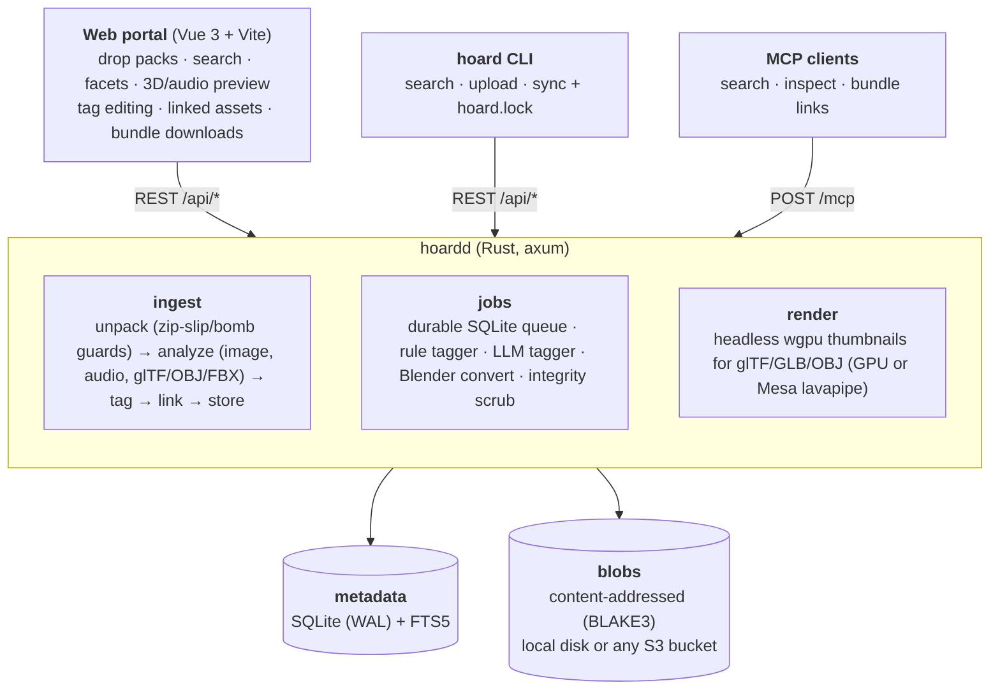

# Hoard

A self-hosted asset library for game development. Drop in whole asset packs (zips, tarballs, folders), and Hoard
stores every file once by its hash, works out what each file is, tags it, links meshes to their textures and
animations, and makes all of it searchable from a web portal, a CLI, an MCP endpoint for agents, and a lockfile-based
`hoard sync` that pulls exactly the files your game project needs.

Think of it as an asset store with no checkout.



## Install with Docker

Hoard ships as one image for amd64 and arm64: `ghcr.io/azazel-labs/hoard`. Save this as `compose.yml` (it's
[deploy/compose.yml](deploy/compose.yml)):

```yaml
services:
  hoard:
    image: ghcr.io/azazel-labs/hoard:${HOARD_VERSION:-latest}
    restart: unless-stopped
    environment:
      HOARD_TOKEN: ${HOARD_TOKEN:?set HOARD_TOKEN, e.g. HOARD_TOKEN=$(openssl rand -hex 32)}
      HOARD_PUBLIC_URL: ${HOARD_PUBLIC_URL:-}
    volumes:
      - hoard-data:/data          # database, files, thumbnails, backups
    ports:
      - "7878:7878"
    labels:
      com.centurylinklabs.watchtower.enable: "true"
      com.centurylinklabs.watchtower.scope: hoard

  # Keeps Hoard up to date: pulls new images at 04:00 and restarts it.
  watchtower:
    image: ghcr.io/nicholas-fedor/watchtower:1.21
    restart: unless-stopped
    volumes:
      - /var/run/docker.sock:/var/run/docker.sock
    environment:
      WATCHTOWER_LABEL_ENABLE: "true"
      WATCHTOWER_SCOPE: hoard
      WATCHTOWER_CLEANUP: "true"
      WATCHTOWER_SCHEDULE: "${HOARD_UPDATE_SCHEDULE:-0 0 4 * * *}"
    labels:
      com.centurylinklabs.watchtower.scope: hoard

volumes:
  hoard-data:
```

Then start it:

```sh
echo "HOARD_TOKEN=$(openssl rand -hex 32)" > .env    # the portal asks for this once before uploads and edits
docker compose up -d                                 # open http://<host>:7878
```

There's no setup wizard: the library starts empty, so drop a pack onto the portal.

**Updates are automatic.** Watchtower pulls each new release, and Hoard upgrades its database on start, saving a copy
in `/data/backups` first. Set `HOARD_VERSION=0.8` in `.env` to get patch releases only, or delete the `watchtower`
service to update by hand (`docker compose pull && docker compose up -d`). The header shows a badge when a newer
release exists.

**GPU (optional).** Hoard renders 3D model thumbnails on the GPU when it can see one, and in software when it can't.
The packs page shows which (`GPU: ...` or `No GPU found`). To pass the GPU through, add the overlay for your
hardware:

```sh
# NVIDIA: needs the NVIDIA driver and the NVIDIA Container Toolkit on the host
docker compose -f compose.yml -f compose.gpu-nvidia.yml up -d

# Intel or AMD, including integrated graphics: needs /dev/dri on the host
echo "RENDER_GID=$(getent group render | cut -d: -f3)" >> .env
docker compose -f compose.yml -f compose.gpu-dri.yml up -d
```

Get both overlays from [deploy/](deploy/). They also put the optional local LLM tagger on the GPU (`--profile llm`
with [compose.private.yml](deploy/compose.private.yml)). Files on a NAS, S3 storage, remote access through Cloudflare
or Tailscale, and backups are covered in [docs/DEPLOYMENT.md](docs/DEPLOYMENT.md).

## Build from source

```sh
# Server (Rust 1.99.1 is pinned in rust-toolchain.toml; rustup installs it automatically)
cargo build --release
(cd web && npm ci && npm run build)
./target/release/hoardd                      # http://127.0.0.1:7878

# Try it with a generated sample pack (textures, PBR set, sprites, audio, glTF/OBJ/GLB models, CC0 license)
python3 tools/make_sample_pack.py /tmp/sample       # needs Pillow + numpy; ffmpeg optional
./target/release/hoard upload /tmp/sample/forest-starter-kit.zip
```

Or drop the zip onto the portal.

### Development

Open the folder in VS Code and accept the recommended extensions (rust-analyzer, CodeLLDB, Vue, TOML, YAML).
Ctrl+Shift+B starts the dev servers; the Run and Debug panel has configurations for `hoardd`, `hoardd` with a local
model, unit tests, the CLI, `xtask`, the portal in the browser, and a "full stack" compound. Everything is also a
`cargo xtask` command, so the terminal and the editor do the same thing:

```sh
cargo xtask dev              # hoardd + Vite with hot reload on http://127.0.0.1:5173; Ctrl-C stops both
cargo xtask dev --llm        # ...plus a local model serving the LLM tagger (downloaded on first use)
cargo xtask ci               # fmt, clippy -D warnings, tests, web build: what CI runs
cargo xtask sample --upload  # generate the sample pack and upload it
cargo xtask web              # build the portal into web/dist
```

### Local models for the tagger

The LLM tagger works with any OpenAI-compatible endpoint, and `cargo xtask` can set up a small one on your machine.
These are vision models (they look at the contact sheets) that run on a laptop CPU:

| Model | Download | License | Notes |
|---|---|---|---|
| `qwen3.5-2b` (default) | ~1.9 GB | Apache-2.0 | Natively multimodal; good at the JSON format |
| `qwen3.5-4b` | ~3.4 GB | Apache-2.0 | Better names and descriptions; wants 6 GB of RAM |
| `qwen3-vl-2b` | ~1.9 GB | Apache-2.0 | Qwen's own GGUF build of the previous generation |
| `gemma4-e2b` | ~3.5 GB | Apache-2.0 | Google's edge model; strong captions |
| `lfm2.5-vl-1.6b` | ~1.3 GB | LFM Open License 1.0 | Smallest and fastest; check the license for commercial use |

```sh
cargo xtask models list               # catalog and what's downloaded
cargo xtask models fetch qwen3.5-4b   # resumable, checked against Hugging Face's SHA-256 (HF_TOKEN for gated repos)
cargo xtask llm serve qwen3.5-4b      # runs llama.cpp and prints the HOARD_LLM_* settings for hoardd
```

Models land in `models/<id>/model.gguf` and `mmproj.gguf` (`HOARD_MODELS_DIR` to put them elsewhere).
Serving needs llama.cpp: `curl -LsSf https://llama.app/install.sh | sh`, `brew install llama.cpp` or
`winget install llama.cpp`. Thinking models are started with reasoning off, since tagging wants a quick JSON answer.
For the NAS, `deploy/compose.private.yml` has an optional `llm` service (`--profile llm`) that serves a downloaded
model with llama.cpp's container image.

### Bulk imports

Imports of many gigabytes work from the browser and the CLI. "Import folder" in the portal (or dropping a folder)
uploads every file in it; a folder that looks like a folder *of* packs can be split into one pack per subfolder.
Uploads go through resumable sessions: the file list is registered first, small files travel in batches and big
ones in 32 MB chunks, and a dropped connection or closed tab picks up where it stopped (drop the same folder again).
The server fingerprints each import (paths and sizes), so re-running a bulk import skips packs it already has
("Import again anyway" or `hoard upload --force` overrides that).

```sh
hoard upload ~/Downloads/Humble-Bundle-2026/ --each    # one pack per subfolder or archive, resumable
```

Model thumbnails need a Vulkan/Metal/DX12/GL adapter. On a headless Linux box without a GPU, install Mesa's
software rasterizer (`apt install mesa-vulkan-drivers`). Without any adapter, everything else still works.

## What happens to a pack

1. **Unpack.** Archives are expanded server-side (zip, tar, tar.gz, and Unity's `.unitypackage`; nested ones too,
   3 levels deep), with `..`/absolute-path rejection and limits on expanded size and file count. A `.unitypackage`
   is rebuilt into its original `Assets/…` tree. `__MACOSX` and `.DS_Store` are dropped; Unity `.meta` files are read
   for their GUIDs (so materials and prefabs link to their textures) and then dropped, along with Godot `.import`
   files. Wrapper folders are collapsed and the innermost folder's name becomes the pack name.
2. **Store.** Each file's BLAKE3 hash is its name in blob storage, so a file shared by ten packs is stored once,
   corruption is detectable, and blobs never change (cache them forever, back them up with any sync tool).
3. **Analyze.**
   - Images: dimensions, alpha, a thumbnail, dominant color, seamless tiling on each axis (edge-continuity test),
     pixel-art detection (few colors, small, upscaled crisply), tangent-space normal map detection.
   - GPU textures, decoded in pure Rust: DDS (BC1-7, raw RGBA/BGRA, float, legacy DXT and bitmask formats) and KTX2
     (BCn, ETC2/EAC, ASTC, raw, with zstd or zlib supercompression), with their GPU format and mip count. Basis
     Universal (KTX2 with BasisLZ/ETC1S or UASTC, and `.basis` files) is transcoded in pure Rust too. SVGs render
     with their text (system fonts, DejaVu in the Docker image), and Aseprite files show their first frame with
     frame, layer and animation-tag counts.
   - Fonts (TTF, OTF, TTC, WOFF, WOFF2): family and style (used as the name), designer, license, weight, italic, monospace,
     variable axes, glyph count and the writing systems covered, with an "Aa" specimen as the thumbnail. Symbol
     fonts show their first glyphs. Tagged `weight:bold`, `script:cyrillic`, `monospace`, `variable-font`, `icons`.
   - Audio: duration, sample rate, channels, embedded title/artist/genre, peak and RMS level (and clipping), plus a
     waveform thumbnail so a sharp hit and a sustained loop look different in the grid: mirrored bars with a solid
     core at the loudness and a halo to the peak, colored by how bright each moment sounds (azure bass, violet and
     orchid mids, orange hiss and cymbals). Formats Hoard doesn't decode
     itself (WMA, CAF, AAC/M4A, Opus, WavPack, APE, …) are decoded through ffmpeg (see below) for the same treatment.
   - Music: tracker modules (MOD, XM, S3M, IT) and MIDI are rendered to audio, so they get a waveform, a duration and
     an MP3 preview that plays in the grid like any other sound. Modules list their title, channels, patterns and
     instruments; MIDI lists tempo, tracks and General MIDI instruments. MIDI plays through a SoundFont
     (`HOARD_SOUNDFONT`, or a GM SoundFont found in the usual system places), falling back to a simple built-in synth.
   - Metadata inside WAVs, as sound libraries ship it: BWF `bext` descriptions, `LIST/INFO` titles and keywords, iXML
     from Soundminer/BaseHead with Universal Category System (UCS) category, subcategory and CatID, `smpl` loop
     points, ACID tempo, root note and one-shot flag, cue markers, and RF64 for files over 4 GB. Embedded titles
     and descriptions become the asset's name and description.
   - Models: glTF/GLB mesh, material, animation and skin counts, vertex/triangle counts; OBJ counts; FBX version
     plus skin and animation detection; a wgpu-rendered thumbnail for glTF/GLB/OBJ/FBX, and for STL, PLY and
     MagicaVoxel `.vox`, which Hoard reads itself (voxels keep their palette colors). Binary FBX geometry, node
     transforms, materials and embedded or nearby textures are read natively (axis and unit settings become glTF's
     Y-up meters); ASCII FBX needs Blender.
   - Unreal packages (`.uasset`, `.umap`), read without Unreal: see [Unreal packs](#unreal-packs).
   - Source files:
     - `.blend`: Blender version, compression, and the preview Blender embeds in every file (read directly, gzip
       or zstd, legacy and 5.0 headers, no Blender needed).
     - `.psd`/`.psb`: size, bit depth, color mode, layer count, and Photoshop's embedded preview.
     - `.kra`/`.ora`: the flattened image and layer count.
     - `.exr`/`.hdr`: tone-mapped previews.
     - Recognized by kind, without previews yet: GIMP, Clip Studio, Affinity, Procreate, Substance, ZBrush, Maya/Max,
       Houdini, C4D, DAW projects, and video.
4. **Tag (offline).** A deterministic tagger tokenizes paths (`FootstepGrass_01` → `footstep grass`), applies a
   game-asset vocabulary (audio-only words such as "run" only apply to audio), adds measured facts (`res:2k`, `pot`,
   `tileable`, `duration:short`, `poly:low`, `rigged`), groups PBR maps into sets (`Rock_Cliff_Normal.png` →
   `map:normal`, `set:rock-cliff`), detects the pack license from LICENSE/README files (`license:cc0`, `cc-by`, …),
   and picks a category from a fixed tree (`sfx/footsteps`, `textures/pbr`, `models/props`, …). Sounds get a UCS
   category (`ucs:footsteps`, `ucs:swooshes/swish`) from embedded metadata or confident rules, plus `loop`,
   `one-shot`, `bpm:120`, `root:a3`, `level:quiet`/`level:loud` and `clipped` where measured.
   - **Variants.** Numbered takes (`whoosh_01..12`, `Hit (3)`, `rock_v2`) in one folder form a family. The detail
     panel lists the other takes, and tag or category edits can apply to all of them at once.
   - **Duplicates.** Byte-identical files across packs (the same CC0 texture in five bundles) are stored once and
     listed under "Identical copies".
   - **Pack context.** README text is kept with the pack, and a store link inside it (Fab, itch.io, Humble Bundle,
     Unity Asset Store, Kenney, …) fills in where the pack came from. "Store details" on the packs page takes the
     store page URL, license tier and listing text; with a URL and no text, Hoard fetches the page's title and
     description.
5. **Link.** glTF buffers/images, OBJ → MTL → textures, FBX texture paths (absolute artist paths are matched by file
   name), DAE images, `.blend` external textures and linked libraries (`//` paths resolved relative to the file),
   `Model@Clip.fbx` animation clips, and name-based guesses for models that reference nothing. Game-engine and
   tool files link too: Unity materials, prefabs, scenes and controllers through their GUIDs; Tiled maps → tilesets
   → images; LDtk projects; BMFont `.fnt` → page images; Spine/libGDX `.atlas` → pages; TexturePacker JSON;
   Godot `.tres`/`.tscn` resources; and Unreal package imports.
6. **Tag (LLM, optional).** Any OpenAI-compatible endpoint (OpenAI, OpenRouter, Ollama, llama.cpp, vLLM, LM Studio)
   gets the pack context, paths, metadata and rule tags, and returns names, one-line descriptions, extra tags, UCS
   subcategories and categories. Each variant family is sent once and the answer applies to every take. With
   `HOARD_LLM_VISION`, each batch also gets one numbered contact sheet of its thumbnails (one image instead of
   sixteen), and models appear as a 2x2 sheet rendered from four directions. It only adds; it never removes rule tags, never overrides anything a
   person edited, and can't flatten a specific category into a vaguer one.
7. **Convert (optional).** With `HOARD_BLENDER` set, .blend/.fbx/.dae/.usd/.ply/.stl/.3ds files are exported to GLB by
   headless Blender, with their linked textures laid out beside them. The GLB is stored as a derivative that feeds
   thumbnails, the browser preview and downloads.

Tags carry their source (`meta`, `rule`, `llm`, `human`). Human tags always win, and re-running the offline
tagger after improving the vocabulary (`POST /api/packs/{id}/retag`) replaces only `rule`/`meta` tags.

## Getting assets into an engine

**Bundles.** Every asset with links has a "Download with N linked files (.zip)" button, built on the fly, that keeps
the original relative layout. Unzip it and `crate.gltf` still finds `crate.bin` and `textures/crate_albedo.png`.
Whole packs download as one zip too, and so does any selection: Ctrl/Cmd-click, Shift-click or press X on tiles
(long-press on a phone), then "Download zip" gets them all with their dependencies, one folder per pack. Zips are
streamed as they're written, so even a multi-gigabyte pack starts downloading at once.

**Download as.** The detail panel's "Download as" converts on request (the first download makes and caches it, so
later ones are instant). Images, models, fonts, WAV/FLAC and music rendering are Hoard's own code; MP3, OGG Vorbis
and Opus use ffmpeg's reference encoders (LAME, libvorbis, libopus), as do sources only ffmpeg reads:

| From | To |
|---|---|
| PNG, JPEG, WebP, TGA, TIFF, BMP, GIF, EXR, HDR, PSD/PSB (full composite), Krita, OpenRaster, DDS, KTX2, SVG, Aseprite | PNG, JPEG, WebP (lossless), TGA, TIFF, plus EXR for HDR sources; optionally scaled down to 4096…64 px, including in the original format |
| WAV, FLAC, OGG Vorbis, MP3, AIFF, and with ffmpeg also AAC/M4A, Opus, WMA, CAF, WavPack, APE, MKA | WAV (16 or 24-bit, as the source), FLAC, MP3 (VBR ~190 kbps), OGG Vorbis (q5), Opus (128 kbps) |
| MOD, XM, S3M, IT, MIDI | the same audio formats, rendered |
| glTF | GLB (buffers and textures packed in) |
| GLB | glTF + .bin (zipped) |
| OBJ (with MTL and textures), binary FBX, STL, PLY, MagicaVoxel | GLB with textures embedded |
| TTF/OTF | WOFF2, WOFF |
| WOFF, WOFF2 | TTF/OTF and each other |
| anything else Blender converted (`HOARD_BLENDER`) | GLB |

`GET /api/assets/{id}/as/{format}[?max=1024]`; the asset detail lists the formats on offer. 16-bit images stay
16-bit; HDR going into an 8-bit format is tone-mapped rather than clipped.

Conversions never hold up the server. They run detached, at most two at a time: a request waits up to `?wait=`
seconds (default 20) and then gets `202` with `{"state": "converting", "progress": 0.4}` and `Retry-After`, while
the conversion carries on even if the client leaves. Requests for the same conversion share it.
`GET /api/assets/{id}/as/{format}/status` starts or checks one without downloading (the portal shows its progress
on the button).

**ffmpeg** is fetched by the server itself: with `HOARD_FFMPEG=auto` (the default) Hoard uses a system ffmpeg that
has LAME, libvorbis and libopus, or else downloads a static build in the background into `<data dir>/tools/ffmpeg`
(Martin Riedl's builds for Linux and macOS, BtbN's for Windows), checks it against the publisher's SHA-256, and uses
it from then on. Set a path to use a specific binary, or `off` to never run it. Until it's ready, or without it
(offline), MP3 and Opus use built-in pure-Rust encoders, and OGG and ffmpeg-only sources aren't offered. ffmpeg only
ever reads uploads with their format forced (no playlists or concat scripts), local files only, under a time
limit. The packs page shows its state.

**Activity.** The pulse icon in the portal's header counts what's running in the background; hover or click it for
the list (ingests with file counts, tagging, conversions, zips being streamed, the ffmpeg download), with progress
and the queued jobs behind them. `GET /api/activity` returns the same.

The portal has light, dark and "match system" themes (the switch beside it), remembered per browser.

**Responsiveness.** Analysis, conversion, rendering, zipping, ffmpeg and Blender run on their own threads at a
lower CPU priority than request handling (Linux `nice` 10, inherited by child processes), so the portal and API stay
quick while a pack ingests on every core.

**Unity.** Bundles of assets that came from a `.unitypackage` (or a Unity project folder) include a minimal `.meta`
for each file with its original GUID, so materials and prefabs still find their textures when you drop the folder
into a Unity project.

**Browsing.** Sounds play straight from the grid (the play button, or Space), with the played part shaded over the
waveform. Arrow keys move through results, Enter opens one, and with the detail panel open the arrows step through
assets for quick triage. Searches and filters live in the URL, so a search can be bookmarked or shared. Files that
only exist to support a model (glTF buffers, `.mtl` libraries) are hidden from the grid by default; they still come
along in downloads.

**`hoard sync`.** A package manager for art. In your game project:

```sh
hoard init        # writes hoard.toml
hoard sync        # downloads, verifies BLAKE3, writes hoard.lock; run again and it downloads nothing
```

```toml
server = "http://nas.local:7878"
out_dir = "assets/hoard"        # Godot: a folder under res://, Unity: Assets/Hoard, Bevy: assets/hoard
layout = "category"             # category | pack | flat
sidecars = true                 # <file>.hoard.json with tags, category, provenance for import scripts
prune = true                    # delete files a previous sync added that nothing selects anymore

[[select]]
query = "footstep"
kind = "audio"
dest = "sfx/footsteps"

[[select]]
tags = ["pbr"]
kind = "texture"

[[select]]
ids = ["0192f0c4-…"]            # pin one model; its textures come along (with_deps = true by default)
with_animations = true
```

Models with dependencies land in their own folder (`models/props/crate/crate.gltf`, `…/crate/textures/…`), so
relative references survive any layout. Commit `hoard.toml` and `hoard.lock`, and teammates get identical,
hash-verified files.

**Manifest API.** Engine plugins can call `POST /api/manifest` with ids and/or a search, plus
`include_deps`, and get a flat list of hashes, sizes, tags, suggested paths and immutable `/api/blobs/{hash}` URLs.

## Unreal packs

Fab and Unreal Marketplace packs often arrive as Unreal content (`Content/<Pack>/…/*.uasset`) rather than FBX, PNG
and WAV. Hoard reads editor packages from UE 4.x through 5.7 directly, without Unreal installed:

- **What it is:** the asset's class (`StaticMesh`, `Texture2D`, `SoundWave`, `MaterialInstanceConstant`, …) sets
  its kind, so a mesh files under models and a sound under audio. Tagged `unreal`, `ue:static-mesh`,
  `engine:ue5.3`.
- **Preview:** the thumbnail the editor saved for its Content Browser (PNG in UE4, JPEG in UE5).
- **Facts:** the asset registry tags the editor writes (texture dimensions, triangle and vertex counts, durations,
  material domains, …), shown in the detail panel and used for the usual tags (`poly:low`, `res:2k`).
- **Links:** each package's imports (`/Game/Pack/Materials/MI_Rock`) are resolved to the pack's own files, so a
  mesh links to its material instance and that to its textures, and a bundle download pulls them all.
- **Names:** naming-convention prefixes are dropped (`SM_TreeStump` → "Tree stump", `T_Rock_N` → "Rock normal").
- **Source files, where Unreal kept them:** a `SoundWave` stores the WAV it was imported from, and UE4-era
  textures keep their source as PNG. Hoard pulls those out: the sound gets a real waveform and plays in the grid,
  the texture gets analyzed like any PNG, and "Download .wav/.png" (or "Recovered WAV/PNG instead of .uasset" on a
  selection zip) gives you the original file.

### Converting to common formats

Hoard can take the content out of the packages and keep it as ordinary files, so a Fab pack ends up as PNGs, WAVs
and FBX like any other pack. It runs after every ingest (`HOARD_UNREAL_CONVERT`, default `keep`) or on demand from
the pack page (More → Convert Unreal content) and `POST /api/packs/{id}/unreal/convert`.

| Package | Becomes | Done by |
|---|---|---|
| `Texture2D` imported from PNG/JPEG | that PNG/JPEG, byte for byte | Hoard |
| `Texture2D` imported uncompressed (TGA, PSD, EXR…) | PNG (8/16-bit) or EXR (HDR) when the pixels are stored plain or LZ4; FBX/PNG/EXR export when Oodle | Hoard, or Unreal Editor |
| `SoundWave` | the imported WAV, byte for byte | Hoard |
| `Material`, `MaterialInstanceConstant` | `material.json`: parent, texture/scalar/vector parameters, PBR slot guesses | Hoard |
| `DataTable` | JSON rows | Hoard |
| `StaticMesh`, `SkeletalMesh`, animations | FBX | Unreal Editor, via `hoard unreal-worker` |
| Blueprints, levels, … | stays a package (nothing to convert it to) | – |

Hoard's reader (`crates/hoard-unreal`) is its own safe Rust, no engine libraries: package summary, tagged
properties (UE 4.x, 5.0-5.3 and 5.4+ layouts), UE4 bulk data and the UE5 package trailer with uncompressed and LZ4
payloads. UE5 compresses raw source data with Oodle by default, which only Unreal decodes, so textures imported
from uncompressed formats usually go to the editor worker. Sources that were compressed when imported (PNG, JPEG)
don't shrink, so Unreal stores them as they are, and Hoard converts those itself.

The converted file takes over the asset: same id, tags, links, collections and family. `GET /api/assets/{id}`
gains an `origin` (original path, class, engine, how it was converted), the Unreal tags stay, and other packages'
references keep resolving to it. With `keep` the original `.uasset` stays downloadable
(`GET /api/assets/{id}/original`); with `replace`, or "Discard the original .uasset files" in the portal, it's
deleted once its content is out. Unreal-only data (material graphs, Blueprint logic) goes with it.

**Meshes and animations** need Unreal itself. Run the worker on any machine with Unreal Editor installed:

```sh
hoard --server https://hoard.example.com unreal-worker --editor "C:/Program Files/Epic Games/UE_5.4/Engine/Binaries/Win64/UnrealEditor-Cmd.exe"
```

It polls `GET /api/unreal/pending`, lays each pack out as a throwaway project with every package at its
`/Game/...` path (inferring the mount when an upload lost the `Content/` folder), runs the bundled export script
headless, uploads the FBX files (`POST /api/assets/{id}/replace`) and has the server re-analyze the pack.
`--once` works through the queue and exits, `--keep-originals` keeps the packages, and `--dry-run` shows the
layout without starting the editor. `cargo xtask unreal-export <pack>/Content --editor …` still exports a local
Content folder directly. Cooked packages from shipped games are recognized but carry no editor data to convert.

Check the license before moving content between engines: Fab's Standard License allows use in other engines and
tools, but some Epic-made content is licensed for Unreal Engine only.

## Collections

A collection is a hand-picked set of assets from any packs, like everything chosen for one level. Select tiles
and use "Add to collection" (typing a new name creates one), or add from an asset's detail panel. Collections sit
at the top of the filter sidebar and on the packs page, download as one zip with their dependencies, and work in
`hoard.toml`:

```toml
[[select]]
collection = "Forest level"
dest = "levels/forest"
```

## MCP for agents

`POST /mcp` is a stateless Streamable HTTP MCP endpoint. It speaks both the 2026-07-28 protocol (per-request `_meta`,
`server/discover`) and the older `initialize` handshake (2025-11-25 back to 2025-03-26), so current and older clients
both connect.

| Tool | What it does |
|---|---|
| `search_assets` | full-text + kind/tag/pack filters, with thumbnail and download URLs; `include_previews` returns the first 8 thumbnails as images |
| `get_asset` | full detail: metadata, tags with sources, links, what uses it, variants, identical copies |
| `get_bundle` | download URLs and save-as paths for an asset and everything it needs, plus a zip URL |
| `list_packs`, `list_tags`, `list_collections` | browse the library, its tag vocabulary and collections (`search_assets` takes `collection` too) |
| `tag_asset`, `update_asset` | edits, recorded as human; need `Authorization: Bearer $HOARD_TOKEN` if a token is set |

Point any MCP client at `https://your-host/mcp` (add the bearer header for write tools). Browser-originated requests
from other origins are rejected (DNS-rebinding guard). Set `HOARD_PUBLIC_URL` so returned links are absolute.

## Storage, and splitting it from the web server

`HOARD_STORAGE=local` keeps blobs under `--data-dir/blobs`. `HOARD_STORAGE=s3` puts them in any S3-compatible bucket:
Garage, RustFS, SeaweedFS or VersityGW on a NAS, or R2/B2/AWS. Downloads are streamed through the server with HTTP
Range support (audio and video seek), and immutable caching headers let a CDN absorb repeat traffic.
`HOARD_S3_HEADERS` adds headers to every storage request, e.g. Cloudflare Access service-token headers when the NAS's
S3 endpoint sits behind Access.

[docs/DEPLOYMENT.md](docs/DEPLOYMENT.md) covers the setups. The recommended one is everything on the NAS, reachable
from anywhere only through Cloudflare One private routing (or Tailscale), with no public hostname
(`deploy/compose.private.yml`). It also covers a public hostname via Cloudflare Tunnel, web on a VPS with blobs on the
NAS, and a Cloudflare-native plan.

## HTTP: TLS, HTTP/2 and HTTP/3

A library page loads hundreds of thumbnails, so connection reuse matters. Over plain HTTP, `hoardd` speaks HTTP/1.1
and cleartext HTTP/2 (h2c), but browsers only use HTTP/2 over TLS. Give it a certificate (`HOARD_TLS_CERT` /
`HOARD_TLS_KEY`, e.g. from `tailscale cert` or any ACME client), or `HOARD_TLS_SELF_SIGNED=true` for a private
network, and the whole grid shares one multiplexed connection (ALPN `h2`). `HOARD_HTTP3=true` adds HTTP/3 over QUIC
on the same port (UDP) and advertises it with `Alt-Svc`; it's experimental. Responses are compressed with
Brotli/zstd/gzip where it helps (not for images, audio, models or zips), the built portal's hashed assets are
cached as immutable, and blob downloads carry ETags and Range support.

## Configuration

Every flag has an env var; `hoardd --help` lists them all.

| Env | Default | |
|---|---|---|
| `HOARD_LISTEN` | `127.0.0.1:7878` | bind address |
| `HOARD_DATA_DIR` | `./hoard-data` | SQLite DB, staging, temp, backups (and blobs when local) |
| `HOARD_WEB_DIR` | `./web/dist` | built portal |
| `HOARD_TLS_CERT` / `_KEY` | – | serve HTTPS (HTTP/2) with this PEM chain and key |
| `HOARD_TLS_SELF_SIGNED` / `HOARD_TLS_NAMES` | `false` / – | HTTPS with a generated certificate for these names |
| `HOARD_HTTP3` | `false` | also serve HTTP/3 (needs TLS) |
| `HOARD_TOKEN` | – | bearer token for uploads, edits, admin and MCP writes; reads stay open |
| `HOARD_STORAGE` | `local` | `local` or `s3` |
| `HOARD_S3_ENDPOINT` / `_BUCKET` / `_REGION` / `_ACCESS_KEY` / `_SECRET_KEY` / `_HEADERS` | – | S3 backend |
| `HOARD_RENDER` | `true` | wgpu model thumbnails |
| `HOARD_BLENDER` | – | path to Blender for format conversion |
| `HOARD_SOUNDFONT` | system GM SoundFont | `.sf2` used to render MIDI |
| `HOARD_FFMPEG` | `auto` | `auto` (system ffmpeg, else download one), a path, or `off` |
| `HOARD_UNREAL_CONVERT` | `keep` | after ingest, convert Unreal packages: `off`, `keep` (keep the .uasset too) or `replace` |
| `HOARD_LLM_URL` / `_MODEL` / `_API_KEY` / `_VISION` / `_BATCH` | – | LLM tagger (URL and model go together) |
| `HOARD_PUBLIC_URL` | Host header | absolute links for MCP |
| `HOARD_MAX_UPLOAD_MB` / `_MAX_EXPAND_MB` / `_MAX_FILES` | 16 GiB / 64 GiB / 200k | upload and zip-bomb limits |
| `HOARD_WORKERS` | `2` | background job workers |

## Keeping it safe

- Content addressing: every byte is verifiable. `POST /api/admin/scrub` re-hashes all blobs (local or S3) and flags
  corrupt or missing ones; the portal shows the count.
- Write-once blobs (read-only on disk), fsync before rename on local storage.
- `POST /api/admin/backup` writes a consistent SQLite snapshot (`VACUUM INTO`). Back up that file plus the blob
  store; blobs never change, so incremental sync is trivial.
- `POST /api/admin/gc` deletes blobs no asset, thumbnail, derivative or kept original references (after deleting
  packs).
- Uploads: path traversal rejected, archive expansion capped, symlinks in tarballs ignored.

## API overview

`GET /api/assets?q=&kind=&tags=a,b&pack=&collection=&ext=&sort=&limit=&offset=&hide_supporting=` (results plus
kind/tag facets) ·
`GET|PATCH /api/assets/{id}` (PATCH takes `apply_to_family`) · `/api/assets/{id}/file[?download=1]` · `/thumb` ·
`/bundle.zip[?animations=1]` · `/derivative/{glb,views}` · `GET /api/bundle.zip?ids=a,b,c[&deps=0][&sources=1]` (a selection) · `/derivative/source` (a recovered WAV/PNG) · `GET|POST /api/packs` · `GET|DELETE /api/packs/{id}` ·
`/retag` · `GET|PUT /context` · `/bundle.zip` · `GET|POST /api/collections` · `GET|PATCH|DELETE /api/collections/{id}` ·
`POST /api/collections/{id}/assets` (`add`/`remove`) · `/api/collections/{id}/bundle.zip[?sources=1]` ·
`/files/{path}` (pack files by original path, used by the 3D viewer) · `GET /api/blobs/{hash}` · `GET /api/tags` ·
`POST /api/packs/{id}/unreal/convert` (`discard_originals`, `drop_unsupported`) · `GET /api/packs/{id}/unreal` ·
`POST /api/packs/{id}/unreal/finish` · `GET /api/unreal/pending` · `POST /api/assets/{id}/replace?ext=` ·
`GET /api/assets/{id}/original` · `GET /api/assets/{id}/as/{format}[?max=&wait=]` (+ `/status`) · `POST /api/manifest` · `GET /api/stats` · `GET /api/activity` · `/api/admin/{jobs,scrub,gc,backup}` · `POST /mcp`. Resumable uploads:
`POST /api/uploads` (file list) · `PUT /api/uploads/{id}/chunk?path=&offset=` (chunks) · `POST /api/uploads/{id}/batch`
(small files) · `GET|DELETE /api/uploads/{id}` · `POST /api/uploads/{id}/complete`.

## Repository layout

```
crates/hoard-core     shared wire types (serde), kind detection, tag normalization
crates/hoard-render   headless wgpu renderer: glTF/GLB/OBJ in, thumbnail out (`cargo run -p hoard-render --example render`)
crates/hoardd         the server
crates/hoard          the CLI
crates/hoard-unreal   Unreal package reader and converters (textures, sounds, materials, data tables)
xtask/                `cargo xtask`: dev servers, checks, local model downloads and serving, Unreal export
web/                  Vue 3 + TypeScript portal (Vite); three.js viewer is lazy-loaded
.vscode/              tasks, debug configurations, settings and recommended extensions
deploy/               Dockerfile companions: compose topologies, Garage config, .env.example
tools/                sample pack generator (now with a small Unreal content folder), Unreal Editor export script
```

Rust 2024 edition, toolchain pinned to 1.99.1, clippy `pedantic` plus panic/footgun lints for the whole workspace
(`[workspace.lints]`), rustfmt at 120 columns. CI runs fmt, clippy `-D warnings`, tests and the web build.

## Status

Built and exercised end to end in development: ingest of the sample pack; offline tagging, PBR sets and license
detection; search and facets; Range proxying; the S3 backend (against a local S3 emulator); scrub catching a
deliberately corrupted blob; the LLM tagger (against a mock OpenAI-compatible server); MCP in both protocol eras;
wgpu thumbnails on lavapipe; link discovery and bundle zips; `hoard sync` including pruning and bundles; the
portal including the three.js viewer on its WebGL2 fallback; and source-format previews and links, checked against
spec-built .blend (raw and zstd), PSD, Krita and EXR files. These were generated from the formats' specs, not saved
by Blender, Photoshop or Krita.

Written but not yet run against the real thing: files saved by real Blender/Photoshop/Krita (please throw some
at it), Blender 5.0's new .blend header, Blender conversion, the Docker image and compose files, Garage/RustFS
specifically, Cloudflare Tunnel/Access, the viewer's WebGPU path on real hardware, and LLM vision mode.

Also exercised: resumable browser and CLI imports of 1.1 GB with an interrupted, resumed run and duplicate refusal;
HTTPS with HTTP/2 and HTTP/3 in Chrome (page, thumbnails and uploads over h3); WAV library metadata, variant
families, duplicate detection, pack context with store-page fetching, contact sheets and multi-view renders against
a mock LLM; and MCP inline previews.

Next ideas: embeddings for "find more like this" and near-duplicates (CLAP for audio, SigLIP 2 for images, or a
multimodal embedding API), BPM and key detection for music (Essentia), previews for more source
formats (GIMP, Substance), and an Unreal-friendly export layout.

## License

[MIT No Attribution](LICENSE) (MIT-0): use, copy, modify and redistribute Hoard for any purpose, with no need to
keep the copyright notice. The asset packs you store in Hoard keep their own licenses.
