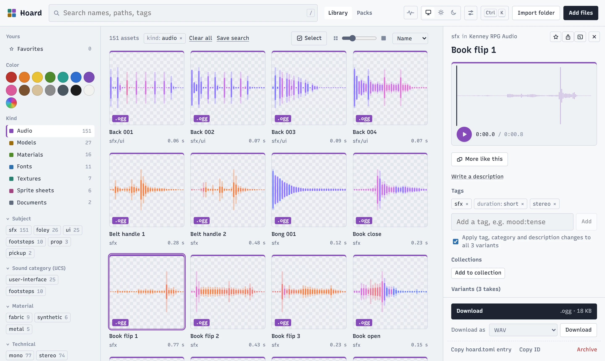

<div align="center">

#  Hoard

[](https://github.com/Azazel-Labs/Hoard/actions/workflows/ci.yml)
[](https://github.com/Azazel-Labs/Hoard/releases/latest)
[](https://www.rust-lang.org)
[](../../LICENSE)
[](https://discord.gg/zf9ncS4EW)

[English](../../README.md)&nbsp;· [Afrikaans](README.af.md)&nbsp;· [Català](README.ca.md)&nbsp;· [Čeština](README.cs.md)&nbsp;· Dansk&nbsp;· [Deutsch](README.de.md)&nbsp;· [Ελληνικά](README.el.md)&nbsp;· [Español&nbsp;(Latinoamérica)](README.es-419.md)&nbsp;· [Español&nbsp;(España)](README.es-ES.md)&nbsp;· [Suomi](README.fi.md)&nbsp;· [Français](README.fr.md)&nbsp;· [Magyar](README.hu.md)&nbsp;· [Bahasa&nbsp;Indonesia](README.id.md)&nbsp;· [Italiano](README.it.md)&nbsp;· [日&#8288;本&#8288;語](README.ja.md)&nbsp;· [한&#8288;국&#8288;어](README.ko.md)&nbsp;· [Norsk&nbsp;bokmål](README.nb.md)&nbsp;· [Nederlands](README.nl.md)&nbsp;· [Polski](README.pl.md)&nbsp;· [Português&nbsp;(Brasil)](README.pt-BR.md)&nbsp;· [Português&nbsp;(Portugal)](README.pt-PT.md)&nbsp;· [Română](README.ro.md)&nbsp;· [Русский](README.ru.md)&nbsp;· [Српски](README.sr-Cyrl.md)&nbsp;· [Svenska](README.sv.md)&nbsp;· [ไ&#8288;ท&#8288;ย](README.th.md)&nbsp;· [Türkçe](README.tr.md)&nbsp;· [Українська](README.uk.md)&nbsp;· [Tiếng&nbsp;Việt](README.vi.md)&nbsp;· [简&#8288;体&#8288;中&#8288;文](README.zh-Hans.md)&nbsp;· [繁&#8288;體&#8288;中&#8288;文](README.zh-Hant.md)

</div>

<h3 align="center">Hver asset-pakke, du ejer, søgbar, med forhåndsvisning og ét klik fra dit spil.</h3>

Hoard er et selvhostet bibliotek til spil-assets. Smid en zip-fil, en Unity-pakke, en Fab-download eller en mappe med ti
tusind filer ind, og Hoard går i gang. Modeller drejer rundt i 3D med deres teksturer, løse teksturmaps bliver til
materialer, lyde tegner deres bølgeformer, sprite-ark afspiller deres animationer, og alt bliver tagget, så du finder
det ved at skrive `footsteps gravel` eller `rigged low-poly`. Derefter lander det i Godot, Unity eller Unreal med alt,
hvad det har brug for.

Intet abonnement, ingen upload til andres sky, ingen pris pr. bruger: ét Docker-image på din egen server, eller en app
på din egen computer, og det er dit. Tænk på det som en asset-butik uden kasse.

<picture>
  <source media="(prefers-color-scheme: dark)" srcset="../img/hero-dark.webp">
  
</picture>

### Se alt, før du bruger det

Modeller åbner i 3D med deres teksturer, materialer og animationer. FBX, glTF, OBJ, USD, SketchUp, 3MF, STL og voxels
læses af Hoard selv, uden at der skal være et 3D-program installeret; Blender-filer kommer ind via en headless Blender,
og Unreal-pakker viser, hvad editoren har gemt om dem, uden Unreal. Miniaturer tegnes på serveren, indrammet på samme
måde hver gang, så en hel pakke kan skimmes med et enkelt blik.

<picture>
  <source media="(prefers-color-scheme: dark)" srcset="../img/page-dark.webp">
  
</picture>

### Løse teksturmaps bliver til materialer

`Rock_BaseColor.png`, `Rock_Normal.png` og `Rock_Roughness.png` bliver til ét Rock-materiale på en belyst kugle. Hoard
forstår navngivningen fra Megascans, Poly Haven, ambientCG, Substance og Unreal, pakkede maps inklusive, og også Unitys
`.mat`-filer. Fuldskærmsfremviseren viser et materiale på en kugle, terning eller flade i dets virkelige størrelse, og
hvert map kan slås til og fra.

<picture>
  <source media="(prefers-color-scheme: dark)" srcset="../img/material-dark.webp">
  
</picture>

### Sprite-ark, der afspilles

Atlasser fra TexturePacker, Starling, libGDX, Cocos2d og Godot bliver til ét sprite-ark, der afspiller sine animationer
og viser sine sprites. Download det pakket om til den motor, du bruger: ti formater, som hver kun får det, de kan rumme.

<picture>
  <source media="(prefers-color-scheme: dark)" srcset="../img/sheet-dark.webp">
  
</picture>

### Lyde, du kan se

Hver lyd får en bølgeform farvet efter, hvor lys den lyder, så et skarpt slag og en lang ambience ser forskellige ud,
før du afspiller dem. Metadata fra lydbiblioteker læses (UCS-kategorier, Soundminer- og BaseHead-felter, loop-punkter,
tempo, grundtone), og MIDI- og tracker-musik renderes, så den afspilles som enhver anden lyd.

<picture>
  <source media="(prefers-color-scheme: dark)" srcset="../img/sound-dark.webp">
  
</picture>

### Søgning, der ved, hvad tingene er

Hoard tagger alt selv, offline: `tileable`, `res:2k`, `poly:low`, `rigged`, `loop`, `bpm:120`, `license:cc0` og en
kategori fra et træ over spil-assets. Søg på ord, på farve eller på, hvad et billede viser, og bed enhver tekstur eller
lyd om »Mere som dette«. Forbind det til en hvilken som helst OpenAI-kompatibel model, lokal eller hostet, så skriver
den også navne og beskrivelser.

<picture>
  <source media="(prefers-color-scheme: dark)" srcset="../img/search-dark.webp">
  
</picture>

### Direkte ind i din motor

- **Motor-plugins** til Godot 4, Unity, Unreal Engine 5 og Lumina: gennemse biblioteket inde i editoren, og tryk på Føj til
  projekt. Modellen kommer med sine teksturer, på det rigtige sted, importeret.
- **`hoard sync`** henter præcis de filer, et projekt angiver, ind i projektet, fastlåst i en lockfil, så alle på holdet
  og alle build-maskiner får de samme bytes.
- **Download som** GLB, PNG, WAV, MP3 eller et sprite-ark-format, konverteret i farten, med teksturnavne efter dit
  studies konvention.
- **AI-agenter** søger i, undersøger og henter assets via MCP.

### Gemt én gang, holdt sikkert

Hver fil gemmes én gang efter sin BLAKE3-hash, så den samme tekstur i fem bundter kun fylder som én, og korruption ikke
kan gå ubemærket hen. Hav det på en lokal disk eller i en hvilken som helst S3-bucket. Mapper, du peger Hoard på, bliver
læst, aldrig ændret. Konti, skrivebeskyttede tokens, single sign-on, HTTPS og HTTP/3 er indbygget.

### Eller bare på din computer

Kører du ikke en server? Desktopappen til Windows, macOS og Linux er det samme bibliotek i sit eget vindue. Installér
den, vælg en mappe, og den virker offline: ingen konti, adgangskoder eller serverindstillinger, intet som resten af
netværket kan nå, og de nøgler, du indtaster, gemmes i systemets nøglering. Nye versioner hentes i baggrunden og
installeres, når den afsluttes.

<picture>
  <source media="(prefers-color-scheme: dark)" srcset="../img/desktop-dark.webp">
  
</picture>

<sub>Demobiblioteket er CC0-grafik: modeller fra [Poly Haven](https://polyhaven.com) (glTF og USD), overflader fra
[ambientCG](https://ambientcg.com) og lyde, sprite-ark og skrifttyper fra [Kenney](https://kenney.nl).
`node web/scripts/readme-images.mts` laver disse billeder og det sociale kort.</sub>

## Installation af desktopappen

Hent den fra den [seneste udgivelse](https://github.com/Azazel-Labs/Hoard/releases/latest): `-setup.exe` til Windows,
`.dmg` til macOS på Apple silicon, `.AppImage` eller `.deb` til Linux. På Windows installeres den kun for dig, uden at
der spørges efter en administrator. Installationsprogrammerne er endnu ikke signeret af Apple eller Microsoft, så
Windows spørger, før installationsprogrammet køres (Flere oplysninger → Kør alligevel), og macOS, før appen åbnes første
gang (Systemindstillinger → Anonymitet & sikkerhed → Åbn alligevel).

Første gang den åbner, spørger den, hvor biblioteket skal ligge. Alt andet findes under Indstillinger, ligesom på en
server.

Derefter holder den sig selv opdateret, uden at du skal klikke på noget: en ny udgivelse hentes i baggrunden og
installeres, når du lukker appen, så næste gang du åbner Hoard, er det den nye version. En `.deb` opdateres ved at
installere den næste.

## Installation med Docker

Hoard leveres som ét image til amd64 og arm64: `ghcr.io/azazel-labs/hoard`. Gem dette som `compose.yml` (det er
[deploy/compose.yml](../../deploy/compose.yml)):

```yaml
services:
  hoard:
    container_name: hoard
    image: ghcr.io/azazel-labs/hoard:latest
    restart: unless-stopped
    volumes:
      - hoard-config:/config      # database, Settings, backups: small, back it up
      - hoard-library:/library    # your files: big, put it on the disk with room
      - hoard-cache:/cache        # thumbnails, uploads in progress, Blender/ffmpeg: fast disk, can be rebuilt
    ports:
      - "4627:4627"

volumes:
  hoard-config:
  hoard-library:
  hoard-cache:
```

Hvert volume kan i stedet være en mappe på den disk, der passer bedst: `/mnt/big/hoard:/library` lægger dine filer på
den store disk, mens databasen forbliver lille og nem at sikkerhedskopiere. Mapper, du monterer, kræver ingen chown:
Hoard overtager `/config` og `/cache` og kører som den, der ejer `/library` (angiv `PUID` og `PGID` for selv at vælge
en bruger).

Start den derefter:

```sh
docker compose up -d        # open http://<host>:4627
```

Ved første besøg bliver du bedt om at oprette en konto, og derefter åbner en kort opsætning, der spørger, hvor dit bibliotek skal ligge. Den foreslår `/library`, volumet ovenfor; vælg
det, og slip en pakke på portalen. Flere placeringer kan tilføjes senere under **Indstillinger → Biblioteksplaceringer**:

- **Et bibliotek, som Hoard opbevarer**, får kopier af det, du uploader eller importerer. Hver af dem afkrydser de
  filtyper, den tager imod (lyd på én disk, modeller på en anden), og én er opsamlingssted for resten. Ændrer du, hvad
  en placering tager imod, gælder det nye filer; **Flyt gemte filer, så de passer** flytter det, der allerede er
  gemt. **Fjern** flytter først en placerings filer til de andre efter type og fjerner den, når den er tom. Hver fil
  kontrolleres mod sin hash, før den gamle kopi slettes. En placering, hvis disk er væk, kan fjernes alligevel, og dens
  filer vises så som manglende.
- **En overvåget mappe** er en mappe med pakker, du allerede har. Hver mappe i den bliver til en pakke, der indekseres,
  hvor den ligger. Hoard ændrer, flytter eller sletter aldrig noget der. Montér den skrivebeskyttet, hvis du vil. Hoard
  gennemgår den ved opstart og derefter hvert 15. minut (eller når du trykker på **Scan nu**) og opfanger nye mapper,
  filer, der er føjet til eller fjernet fra en pakke, og pakker, hvis mappe er væk. En mappe, der pludselig er tom
  eller ikke kan nås, opfattes som en disk, der ikke er monteret, og dens pakker beholdes. En pakke, hvis mappe
  mangler, beholdes i tre dage med sine tags og noter, hvis nu mappen kommer tilbage. Alt, hvad du sletter for altid
  fra en overvåget pakke, forbliver slettet, når mappen scannes igen, selvom filerne stadig ligger der.

En placering er en hvilken som helst mappe, serveren kan se, så i Docker skal du først montere den i containeren.

**Opdatering.** Topbjælken viser et mærke, når der findes en nyere udgivelse. Kør `docker compose pull && docker compose up -d`
for at hente den; Hoard opgraderer sin database ved start og gemmer først en kopi i `/config/backups`. Skift image-tagget til
`:1.3` for kun at få patch-udgivelser. For at opdatere automatisk uden at genstarte Hoard midt i en upload kan du give
**Indstillinger → Vedligeholdelse → Opdateringer** en adresse at kalde: Hoard kalder den, når en udgivelse er ude, og der ikke sker noget
(Watchtowers HTTP-API, en Portainer-webhook, et script; se [docs/DEPLOYMENT.md](../DEPLOYMENT.md#updating)).

**GPU (valgfri).** Hoard renderer miniaturer af 3D-modeller på GPU'en, når den kan se en, og i software, når den ikke kan.
Pakkesiden viser hvilken (`GPU: ...` eller `No GPU found`). For at give containeren adgang til GPU'en skal du tilføje
overlayet til din hardware:

```sh
# NVIDIA: needs the NVIDIA driver and the NVIDIA Container Toolkit on the host
docker compose -f compose.yml -f compose.gpu-nvidia.yml up -d

# Intel or AMD, including integrated graphics: needs /dev/dri on the host
echo "RENDER_GID=$(getent group render | cut -d: -f3)" >> .env
docker compose -f compose.yml -f compose.gpu-dri.yml up -d
```

Hent begge overlays fra [deploy/](../../deploy/). De lægger også den lokale modelserver (AI-tagging) på GPU'en. Filer på en NAS, S3-lager, fjernadgang via Cloudflare
eller Tailscale og sikkerhedskopier er beskrevet i [docs/DEPLOYMENT.md](../DEPLOYMENT.md).

## Byg fra kildekoden

```sh
# Server (stable Rust via rust-toolchain.toml, MSRV 1.100; rustup installs it automatically)
cargo build --release
(cd web && npm ci && npm run build)
./target/release/hoardd                      # http://127.0.0.1:4627

# Try it with a generated sample pack (textures, PBR set, sprites, audio, glTF/OBJ/GLB models, CC0 license)
python3 tools/make_sample_pack.py /tmp/sample       # needs Pillow + numpy; ffmpeg optional
./target/release/hoard --token <token> upload /tmp/sample/forest-starter-kit.zip   # make the token in Settings → Account
```

Eller slip zip-filen på portalen.

## Resten af denne README

Hvad der sker med en pakke, hvordan du får assets ind i en motor, Unreal-pakker, søgning, krediteringer, MCP, lagring,
HTTPS, konfiguration, sikkerhed, konti, API'et samt fakta og tal er beskrevet i den
[engelske README](../../README.md).

## Oversættelser

Hoards portal og servermeddelelser findes på 31 sprog og vælges under Indstillinger → Udseende (som standard browserens
sprog). De første oversættelser blev lavet med hjælp fra maskinoversættelse; rettelser fra modersmålstalende er velkomne. [docs/translations.md](../translations.md) forklarer hvordan.

## Fællesskab

Spørgsmål, idéer eller noget at vise frem? Kig forbi på [Azazel Labs’ Discord](https://discord.gg/zf9ncS4EW). Fejl og ønsker til funktioner meldes bedst som [GitHub-issues](https://github.com/Azazel-Labs/Hoard/issues), hvor de ikke bliver væk.

## Licens

[MIT No Attribution](../../LICENSE) (MIT-0): brug, kopiér, ændr og videredistribuér Hoard til ethvert formål uden at
skulle bevare copyrightmeddelelsen. De asset-pakker, du gemmer i Hoard, beholder deres egne licenser.
