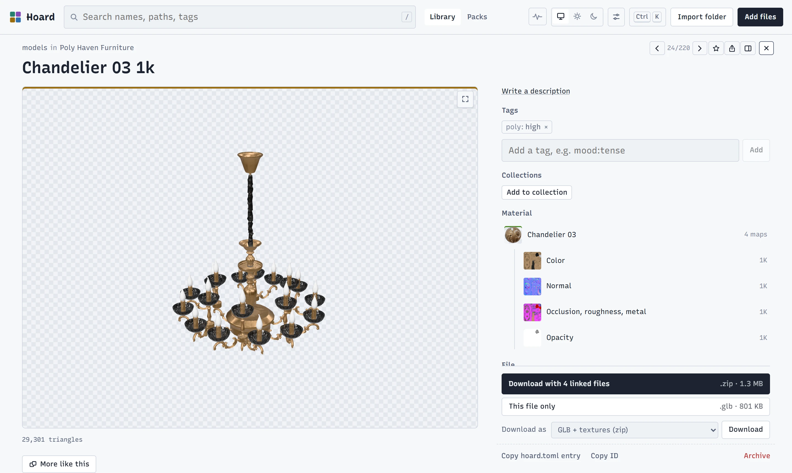

# Hoard

[](https://github.com/Azazel-Labs/Hoard/actions/workflows/ci.yml)
[](https://github.com/Azazel-Labs/Hoard/releases/latest)
[](https://www.rust-lang.org)
[](../../LICENSE)

[English](../../README.md) · [Afrikaans](README.af.md) · [Català](README.ca.md) · [Čeština](README.cs.md) · [Dansk](README.da.md) · [Deutsch](README.de.md) · [Ελληνικά](README.el.md) · Español (Latinoamérica) · [Español (España)](README.es-ES.md) · [Suomi](README.fi.md) · [Français](README.fr.md) · [Magyar](README.hu.md) · [Bahasa Indonesia](README.id.md) · [Italiano](README.it.md) · [日本語](README.ja.md) · [한국어](README.ko.md) · [Norsk bokmål](README.nb.md) · [Nederlands](README.nl.md) · [Polski](README.pl.md) · [Português (Brasil)](README.pt-BR.md) · [Português (Portugal)](README.pt-PT.md) · [Română](README.ro.md) · [Русский](README.ru.md) · [Српски](README.sr-Cyrl.md) · [Svenska](README.sv.md) · [ไทย](README.th.md) · [Türkçe](README.tr.md) · [Українська](README.uk.md) · [Tiếng Việt](README.vi.md) · [简体中文](README.zh-Hans.md) · [繁體中文](README.zh-Hant.md)

<h3 align="center">Cada paquete de recursos que tienes, con búsqueda, vista previa y a un clic de tu juego.</h3>

Hoard es una biblioteca autoalojada de recursos para videojuegos. Suelta un zip, un paquete de Unity, una descarga de
Fab o una carpeta con diez mil archivos, y Hoard se pone a trabajar. Los modelos giran en 3D con sus texturas, los mapas
de textura sueltos se convierten en materiales, los sonidos dibujan sus formas de onda, las hojas de sprites reproducen
sus animaciones y todo queda etiquetado, así que lo encuentras con solo escribir `footsteps gravel` o `rigged low-poly`.
Después llega a Godot, Unity o Unreal con todo lo que necesita.

Sin suscripción, sin subir nada a la nube de nadie, sin precios por usuario: una imagen de Docker en tu propia máquina,
y es tuya. Piénsalo como una tienda de recursos sin caja.

<picture>
  <source media="(prefers-color-scheme: dark)" srcset="../img/hero-dark.webp">
  
</picture>

### Míralo todo antes de usarlo

Los modelos se abren en 3D con sus texturas, materiales y animaciones. Hoard lee por sí mismo FBX, glTF, OBJ, USD,
SketchUp, 3MF, STL y vóxeles, sin ninguna aplicación 3D instalada; los archivos de Blender entran mediante un Blender
sin interfaz, y los paquetes de Unreal muestran lo que el editor guardó sobre ellos, sin Unreal. Las miniaturas se
dibujan en el servidor, encuadradas siempre de la misma manera, para que puedas recorrer un paquete entero de un
vistazo.

<picture>
  <source media="(prefers-color-scheme: dark)" srcset="../img/page-dark.webp">
  
</picture>

### Los mapas de textura sueltos se convierten en materiales

`Rock_BaseColor.png`, `Rock_Normal.png` y `Rock_Roughness.png` se convierten en un solo material Rock sobre una esfera
iluminada. Hoard entiende los nombres de Megascans, Poly Haven, ambientCG, Substance y Unreal, incluidos los mapas
empaquetados, y también los archivos `.mat` de Unity. El visor a pantalla completa muestra un material sobre una esfera,
un cubo o un plano, a su escala real, y cada mapa se puede activar y desactivar.

<picture>
  <source media="(prefers-color-scheme: dark)" srcset="../img/material-dark.webp">
  
</picture>

### Hojas de sprites que se reproducen

Los atlas de TexturePacker, Starling, libGDX, Cocos2d y Godot se convierten en una sola hoja de sprites que reproduce
sus animaciones y enumera sus sprites. Descárgala reempaquetada para el motor que estés usando: diez formatos, y a cada
uno solo se le da lo que puede contener.

<picture>
  <source media="(prefers-color-scheme: dark)" srcset="../img/sheet-dark.webp">
  
</picture>

### Sonidos que puedes ver

Cada sonido recibe una forma de onda coloreada según lo brillante que suena, así que un golpe seco y un ambiente largo
se ven distintos antes de reproducirlos. Se leen los metadatos de bibliotecas de sonido (categorías UCS, campos de
Soundminer y BaseHead, puntos de bucle, tempo, nota raíz), y la música MIDI y de tracker se renderiza para que se
reproduzca como cualquier otro sonido.

<picture>
  <source media="(prefers-color-scheme: dark)" srcset="../img/sound-dark.webp">
  
</picture>

### Una búsqueda que sabe qué es cada cosa

Hoard lo etiqueta todo por sí mismo, sin conexión: `tileable`, `res:2k`, `poly:low`, `rigged`, `loop`, `bpm:120`,
`license:cc0`, y una categoría de un árbol de recursos para videojuegos. Busca por palabras, por color o por lo que
muestra una imagen, y pídele a cualquier textura o sonido “Más como este”. Conéctalo a cualquier modelo compatible con
OpenAI, local o alojado, y también escribe nombres y descripciones.

<picture>
  <source media="(prefers-color-scheme: dark)" srcset="../img/search-dark.webp">
  
</picture>

### Directo a tu motor

- **Plugins para motores** Godot 4, Unity y Unreal Engine 5: explora la biblioteca dentro del editor y presiona Agregar
  al proyecto. El modelo llega con sus texturas, en el lugar correcto, ya importado.
- **`hoard sync`** trae a un proyecto exactamente los archivos que este indica, fijados en un lockfile, para que cada
  compañero de equipo y cada máquina de compilación reciba los mismos bytes.
- **Descargar como** GLB, PNG, WAV, MP3 o un formato de hoja de sprites, convertido al vuelo, con nombres de textura
  según la convención de tu estudio.
- **Los agentes de IA** buscan, inspeccionan y obtienen recursos por MCP.

### Guardado una vez, a salvo

Cada archivo se guarda una sola vez según su hash BLAKE3, así que la misma textura en cinco paquetes ocupa el espacio de
una, y ninguna corrupción puede pasar inadvertida. Guárdalo en un disco local o en cualquier bucket de S3. Las carpetas
que le indicas a Hoard se leen, nunca se modifican. Cuentas, tokens de solo lectura, inicio de sesión único, HTTPS y
HTTP/3 vienen incluidos.

<sub>La biblioteca de demostración es arte CC0: modelos de [Poly Haven](https://polyhaven.com) (glTF y USD), superficies
de [ambientCG](https://ambientcg.com) y sonidos, hojas de sprites y fuentes de [Kenney](https://kenney.nl).
`node web/scripts/readme-images.mts` genera estas imágenes y la tarjeta para redes sociales.</sub>

## Instalar con Docker

Hoard se distribuye como una sola imagen para amd64 y arm64: `ghcr.io/azazel-labs/hoard`. Guarda esto como
`compose.yml` (es [deploy/compose.yml](../../deploy/compose.yml)):

```yaml
services:
  hoard:
    container_name: hoard
    image: ghcr.io/azazel-labs/hoard:latest
    restart: unless-stopped
    volumes:
      - hoard-config:/config      # database, Settings, backups: small, back it up
      - hoard-library:/library    # your files: big, put it on the disk with room
      - hoard-cache:/cache        # thumbnails, uploads in progress, Blender/ffmpeg: fast disk, can be rebuilt
    ports:
      - "4627:4627"

volumes:
  hoard-config:
  hoard-library:
  hoard-cache:
```

Cada volumen puede ser, en cambio, una carpeta en el disco que más le convenga: `/mnt/big/hoard:/library` pone tus
archivos en el disco grande, mientras la base de datos sigue siendo pequeña y fácil de respaldar. Las carpetas que
montes no necesitan chown: Hoard se encarga de `/config` y `/cache` y se ejecuta como el dueño de `/library` (define
`PUID` y `PGID` para elegir un usuario tú mismo).

Luego inícialo:

```sh
docker compose up -d        # open http://<host>:4627
```

La primera visita te pide crear una cuenta y luego abre una breve configuración que pregunta dónde está tu biblioteca. Sugiere `/library`, el volumen de arriba; elígelo
y suelta un paquete en el portal. Más adelante puedes agregar más ubicaciones desde **Configuración → Ubicaciones de la biblioteca**:

- **Una biblioteca que guarda Hoard** recibe copias de lo que subes o importas. Cada una marca los tipos de archivo
  que acepta (audio en un disco, modelos en otro), y una es la general para el resto. Cambiar lo que acepta una
  ubicación se aplica a los archivos nuevos; **Mover los archivos guardados según esto** mueve lo que ya está guardado.
  **Quitar** primero mueve los archivos de una ubicación a las demás, según su tipo, y la quita cuando queda vacía.
  Cada archivo se comprueba con su hash antes de eliminar la copia anterior. Una ubicación cuyo disco ya no está se
  puede quitar de todas formas, y entonces sus archivos aparecen como faltantes.
- **Una carpeta vigilada** es una carpeta de paquetes que ya tienes. Cada carpeta dentro de ella se convierte en un
  paquete, indexado donde está. Hoard nunca cambia, mueve ni elimina nada ahí. Puedes montarla como solo lectura si
  quieres. Hoard la revisa al iniciar y cada 15 minutos después (o cuando presionas **Escanear ahora**), y detecta
  carpetas nuevas, archivos agregados a un paquete o quitados de él, y paquetes cuya carpeta ya no está. Una carpeta
  que de pronto está vacía o inaccesible se toma por un disco que no está montado, y sus paquetes se conservan. Un
  paquete cuya carpeta falta se conserva durante tres días, con sus etiquetas y notas, por si la carpeta vuelve. Lo
  que elimines definitivamente de un paquete vigilado sigue eliminado cuando se vuelve a escanear la carpeta, aunque
  sus archivos sigan ahí.

Una ubicación es cualquier carpeta que el servidor pueda ver, así que en Docker, móntala primero en el contenedor.

**Actualizar.** La barra superior muestra una insignia cuando hay una versión más reciente. Ejecuta
`docker compose pull && docker compose up -d` para instalarla; Hoard actualiza su base de datos al iniciar, y antes
guarda una copia en `/config/backups`. Cambia la etiqueta de la imagen a `:1.2` para recibir solo versiones de
corrección. Para actualizar automáticamente sin reiniciar Hoard en medio de una subida, indica en
**Configuración → Mantenimiento → Actualizaciones** una dirección a la que llamar: Hoard la llama cuando sale una
versión y no hay nada en curso (la API HTTP de Watchtower, un webhook de Portainer, un script; consulta
[docs/DEPLOYMENT.md](../DEPLOYMENT.md#updating)).

**GPU (opcional).** Hoard genera las miniaturas de los modelos 3D en la GPU cuando puede ver una, y por software
cuando no. La página de paquetes muestra cuál usa (`GPU: ...` o `No GPU found`). Para darle acceso a la GPU, agrega
el overlay para tu hardware:

```sh
# NVIDIA: needs the NVIDIA driver and the NVIDIA Container Toolkit on the host
docker compose -f compose.yml -f compose.gpu-nvidia.yml up -d

# Intel or AMD, including integrated graphics: needs /dev/dri on the host
echo "RENDER_GID=$(getent group render | cut -d: -f3)" >> .env
docker compose -f compose.yml -f compose.gpu-dri.yml up -d
```

Obtén ambos overlays en [deploy/](../../deploy/). También ponen en la GPU el servidor de modelos local (etiquetado
con IA). Los archivos en un NAS, el almacenamiento S3, el acceso remoto a través de Cloudflare o Tailscale y los
respaldos se explican en [docs/DEPLOYMENT.md](../DEPLOYMENT.md).

## Compilar desde el código fuente

```sh
# Server (stable Rust via rust-toolchain.toml, MSRV 1.100; rustup installs it automatically)
cargo build --release
(cd web && npm ci && npm run build)
./target/release/hoardd                      # http://127.0.0.1:4627

# Try it with a generated sample pack (textures, PBR set, sprites, audio, glTF/OBJ/GLB models, CC0 license)
python3 tools/make_sample_pack.py /tmp/sample       # needs Pillow + numpy; ffmpeg optional
./target/release/hoard --token <token> upload /tmp/sample/forest-starter-kit.zip   # make the token in Settings → Account
```

O suelta el zip en el portal.

## El resto de este README

Lo que le pasa a un paquete, cómo llevar recursos a un motor, los paquetes de Unreal, la búsqueda, los créditos, MCP,
el almacenamiento, HTTPS, la configuración, la seguridad, las cuentas, la API y los datos y cifras se describen en
el [README en inglés](../../README.md).

## Traducciones

El portal y los mensajes del servidor de Hoard están disponibles en 31 idiomas, que se eligen en Configuración →
Apariencia (de forma predeterminada, el idioma del navegador). Las primeras traducciones se hicieron con ayuda de
máquinas; las correcciones de hablantes nativos son bienvenidas. [docs/translations.md](../translations.md) explica
cómo.

## Licencia

[MIT No Attribution](../../LICENSE) (MIT-0): usa, copia, modifica y redistribuye Hoard para cualquier propósito, sin
necesidad de conservar el aviso de copyright. Los paquetes de recursos que guardas en Hoard conservan sus propias
licencias.
