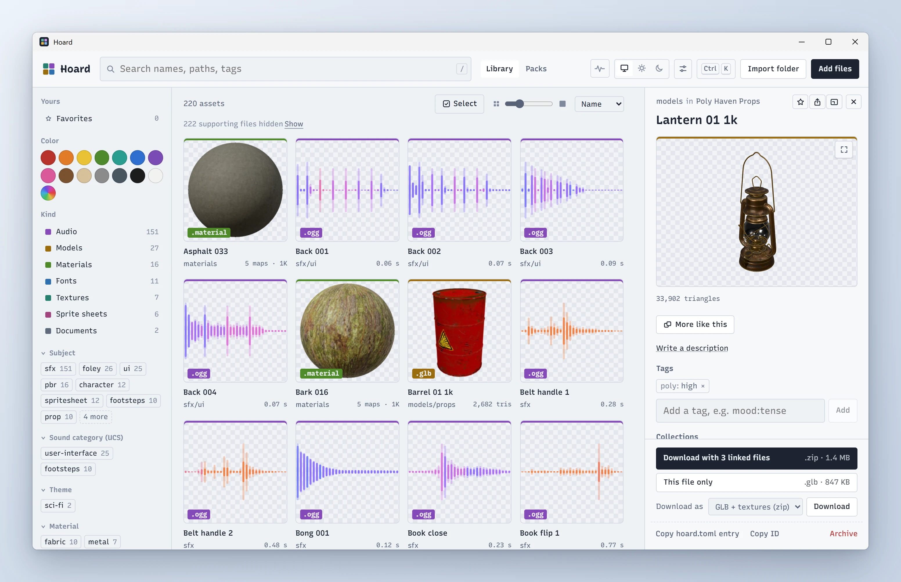

<div align="center">

#  Hoard

[](https://github.com/Azazel-Labs/Hoard/actions/workflows/ci.yml)
[](https://github.com/Azazel-Labs/Hoard/releases/latest)
[](https://www.rust-lang.org)
[](../../LICENSE)
[](https://discord.gg/zf9ncS4EW)

[English](../../README.md)&nbsp;· [Afrikaans](README.af.md)&nbsp;· [Català](README.ca.md)&nbsp;· [Čeština](README.cs.md)&nbsp;· [Dansk](README.da.md)&nbsp;· [Deutsch](README.de.md)&nbsp;· [Ελληνικά](README.el.md)&nbsp;· [Español&nbsp;(Latinoamérica)](README.es-419.md)&nbsp;· [Español&nbsp;(España)](README.es-ES.md)&nbsp;· Suomi&nbsp;· [Français](README.fr.md)&nbsp;· [Magyar](README.hu.md)&nbsp;· [Bahasa&nbsp;Indonesia](README.id.md)&nbsp;· [Italiano](README.it.md)&nbsp;· [日&#8288;本&#8288;語](README.ja.md)&nbsp;· [한&#8288;국&#8288;어](README.ko.md)&nbsp;· [Norsk&nbsp;bokmål](README.nb.md)&nbsp;· [Nederlands](README.nl.md)&nbsp;· [Polski](README.pl.md)&nbsp;· [Português&nbsp;(Brasil)](README.pt-BR.md)&nbsp;· [Português&nbsp;(Portugal)](README.pt-PT.md)&nbsp;· [Română](README.ro.md)&nbsp;· [Русский](README.ru.md)&nbsp;· [Српски](README.sr-Cyrl.md)&nbsp;· [Svenska](README.sv.md)&nbsp;· [ไ&#8288;ท&#8288;ย](README.th.md)&nbsp;· [Türkçe](README.tr.md)&nbsp;· [Українська](README.uk.md)&nbsp;· [Tiếng&nbsp;Việt](README.vi.md)&nbsp;· [简&#8288;体&#8288;中&#8288;文](README.zh-Hans.md)&nbsp;· [繁&#8288;體&#8288;中&#8288;文](README.zh-Hant.md)

</div>

<h3 align="center">Jokainen omistamasi resurssipaketti haettavana, esikatseltavana ja yhden klikkauksen päässä pelistäsi.</h3>

Hoard on itse ylläpidettävä kirjasto pelien resursseille. Pudota sisään zip, Unity-paketti, Fabista ladattu paketti tai
kymmenentuhannen tiedoston kansio, ja Hoard ryhtyy töihin. Mallit pyörivät 3D:nä tekstuureineen, irralliset
tekstuurikartat kootaan materiaaleiksi, äänet piirtävät aaltomuotonsa, sprite-arkit toistavat animaationsa, ja kaikki
saa tunnisteet, joten löydät etsimäsi kirjoittamalla `footsteps gravel` tai `rigged low-poly`. Sitten se päätyy
Godotiin, Unityyn tai Unrealiin kaiken tarvitsemansa kanssa.

Ei tilausta, ei latausta kenenkään pilveen, ei käyttäjäkohtaista hinnoittelua: yksi Docker-image omalla palvelimellasi
tai sovellus omalla tietokoneellasi, ja se on sinun. Ajattele sitä resurssikauppana ilman kassaa.

<picture>
  <source media="(prefers-color-scheme: dark)" srcset="../img/hero-dark.webp">
  
</picture>

### Näe kaikki ennen kuin käytät sitä

Mallit avautuvat 3D:nä tekstuureineen, materiaaleineen ja animaatioineen. Hoard lukee itse FBX-, glTF-, OBJ-, USD-,
SketchUp-, Collada-, X3D-, VRM-, 3MF- ja STL-tiedostot sekä vokselit ilman asennettua 3D-ohjelmaa; Blender-tiedostot tuodaan ilman
käyttöliittymää ajettavan Blenderin kautta, ja Unreal-paketeista näkyy, mitä editori on tallentanut niistä, ilman
Unrealia. Pikkukuvat piirretään palvelimella ja rajataan joka kerta samalla tavalla, joten koko paketin voi silmäillä
yhdellä vilkaisulla.

<picture>
  <source media="(prefers-color-scheme: dark)" srcset="../img/page-dark.webp">
  
</picture>

### Irralliset tekstuurikartat muuttuvat materiaaleiksi

`Rock_BaseColor.png`, `Rock_Normal.png` ja `Rock_Roughness.png` muuttuvat yhdeksi Rock-materiaaliksi valaistulla
pallolla. Hoard tuntee Megascansin, Poly Havenin, ambientCG:n, Substancen ja Unrealin nimeämistavat, pakatut kartat
mukaan lukien, ja lukee myös Unityn `.mat`-tiedostot. Koko näytön katseluohjelma näyttää materiaalin pallolla, kuutiolla
tai tasolla sen todellisessa mittakaavassa, ja jokaisen kartan voi kytkeä päälle ja pois.

<picture>
  <source media="(prefers-color-scheme: dark)" srcset="../img/material-dark.webp">
  
</picture>

### Sprite-arkit, jotka toistavat animaationsa

TexturePackerin, Starlingin, libGDX:n, Cocos2d:n ja Godotin atlakset muuttuvat yhdeksi sprite-arkiksi, joka toistaa
animaationsa ja luettelee spritensä. Lataa se uudelleen pakattuna juuri sille moottorille, jota käytät: kymmenen
formaattia, ja kullekin kerrotaan vain se, mitä se pystyy sisältämään.

<picture>
  <source media="(prefers-color-scheme: dark)" srcset="../img/sheet-dark.webp">
  
</picture>

### Äänet, jotka näet

Jokainen ääni saa aaltomuodon, joka on väritetty sen mukaan, kuinka kirkkaalta ääni kuulostaa, joten terävä isku ja
pitkä taustaääni näyttävät erilaisilta jo ennen kuin soitat niitä. Äänikirjastojen metatiedot luetaan (UCS-luokat,
Soundminerin ja BaseHeadin kentät, silmukkapisteet, tempo, pohjasävel), ja MIDI- ja tracker-musiikki renderöidään niin,
että se soi kuten mikä tahansa muu ääni.

<picture>
  <source media="(prefers-color-scheme: dark)" srcset="../img/sound-dark.webp">
  
</picture>

### Haku, joka tietää, mitä asiat ovat

Hoard merkitsee kaiken tunnisteilla itse, ilman verkkoyhteyttä: `tileable`, `res:2k`, `poly:low`, `rigged`, `loop`,
`bpm:120`, `license:cc0` sekä luokan peliresurssien luokkapuusta. Hae sanoilla, värillä tai sillä, mitä kuvassa näkyy,
ja pyydä mistä tahansa tekstuurista tai äänestä ”Lisää samankaltaisia”. Osoita se mihin tahansa OpenAI-yhteensopivaan
malliin, paikalliseen tai pilvessä toimivaan, niin se kirjoittaa myös nimet ja kuvaukset.

<picture>
  <source media="(prefers-color-scheme: dark)" srcset="../img/search-dark.webp">
  
</picture>

### Suoraan pelimoottoriisi

- **Moottorilaajennukset** Godot 4:lle, Unitylle, Unreal Engine 5:lle ja Luminalle: selaa kirjastoa editorin sisällä ja paina Lisää
  projektiin. Malli tulee tekstuureineen, oikeaan paikkaan ja valmiiksi tuotuna.
- **`hoard sync`** hakee projektiin juuri ne tiedostot, jotka projekti nimeää, lukitustiedostoon kiinnitettyinä, joten
  jokainen tiimiläinen ja käännöskone saa täsmälleen samat tavut.
- **Lataa muodossa** GLB, PNG, WAV, MP3 tai sprite-arkkiformaatti, muunnettuna lennossa ja tekstuurien nimet studiosi
  käytännön mukaisina.
- **Tekoälyagentit** hakevat, tarkastelevat ja noutavat resursseja MCP:n kautta ja voivat tehdä kaiken muunkin,
  mitä portaali tekee, sen tilin tai tunnuksen oikeuksin, jolla ne kirjautuvat.

### Tallennettu kerran, pidetty turvassa

Jokainen tiedosto tallennetaan kerran sen BLAKE3-tiivisteen perusteella, joten sama tekstuuri viidessä paketissa vie
vain yhden tekstuurin verran tilaa, eikä tietojen vioittuminen voi jäädä huomaamatta. Säilytä tiedostot paikallisella
levyllä tai missä tahansa S3-säilössä. Kansiot, joihin Hoardin osoitat, luetaan mutta niitä ei koskaan muuteta. Tilit,
vain luku -tunnukset, kertakirjautuminen, HTTPS ja HTTP/3 ovat valmiina mukana.

### Tai vain omalla tietokoneellasi

Eikö sinulla ole palvelinta? Työpöytäsovellus Windowsille, macOS:lle ja Linuxille on sama kirjasto omassa ikkunassaan.
Asenna se, valitse kansio, ja se toimii ilman verkkoyhteyttä: ei tilejä, salasanoja eikä palvelinasetuksia, ei mitään,
mihin muu verkko pääsisi käsiksi, ja kirjoittamasi avaimet säilyvät järjestelmän avainnipussa. Uudet versiot latautuvat
taustalla ja asentuvat, kun sovellus suljetaan.

<picture>
  <source media="(prefers-color-scheme: dark)" srcset="../img/desktop-dark.webp">
  
</picture>

<sub>Esittelykirjaston grafiikka on CC0-lisensoitua: mallit [Poly Havenista](https://polyhaven.com) (glTF ja USD),
pinnat [ambientCG:stä](https://ambientcg.com) sekä äänet, sprite-arkit ja fontit [Kenneyltä](https://kenney.nl).
`node web/scripts/readme-images.mts` tekee nämä kuvat ja some-kortin.</sub>

## Työpöytäsovelluksen asennus

Lataa se [uusimmasta julkaisusta](https://github.com/Azazel-Labs/Hoard/releases/latest): `-setup.exe` Windowsille,
`.dmg` Apple silicon -koneiden macOS:lle, `.AppImage` tai `.deb` Linuxille. Windowsissa se asentuu vain sinulle eikä
pyydä järjestelmänvalvojan oikeuksia. Apple tai Microsoft ei ole vielä allekirjoittanut asennusohjelmia, joten Windows
kysyy ennen asennusohjelman suorittamista (Lisätietoja → Suorita silti) ja macOS ennen sovelluksen ensimmäistä avaamista
(Järjestelmäasetukset → Yksityisyys ja suojaus → Avaa silti).

Kun sovellus avataan ensimmäisen kerran, se kysyy, mihin kirjasto tulee. Kaikki muu on Asetuksissa, kuten
palvelimellakin.

Sen jälkeen sovellus pitää itsensä ajan tasalla, eikä sinun tarvitse klikata mitään: uusi julkaisu latautuu taustalla ja
asentuu, kun suljet sovelluksen, joten kun seuraavan kerran avaat Hoardin, se on jo uusi versio. `.deb`-paketti
päivitetään asentamalla seuraava.

## Asennus Dockerilla

Hoard toimitetaan yhtenä levykuvana amd64- ja arm64-alustoille: `ghcr.io/azazel-labs/hoard`. Tallenna tämä nimellä
`compose.yml` (se on [deploy/compose.yml](../../deploy/compose.yml)):

```yaml
services:
  hoard:
    container_name: hoard
    image: ghcr.io/azazel-labs/hoard:latest
    restart: unless-stopped
    volumes:
      - hoard-config:/config      # database, Settings, backups: small, back it up
      - hoard-library:/library    # your files: big, put it on the disk with room
      - hoard-cache:/cache        # thumbnails, uploads in progress, Blender/ffmpeg: fast disk, can be rebuilt
    ports:
      - "4627:4627"

volumes:
  hoard-config:
  hoard-library:
  hoard-cache:
```

Kukin taltio voi sen sijaan olla kansio sille parhaiten sopivalla levyllä: `/mnt/big/hoard:/library` laittaa tiedostosi
isolle levylle, kun taas tietokanta pysyy pienenä ja helposti varmuuskopioitavana. Liittämiäsi kansioita ei tarvitse
chownata: Hoard ottaa haltuunsa kansiot `/config` ja `/cache` ja toimii sen käyttäjän oikeuksin, joka omistaa kansion
`/library` (aseta `PUID` ja `PGID`, jos haluat valita käyttäjän itse).

Käynnistä se sitten:

```sh
docker compose up -d        # open http://<host>:4627
```

Ensimmäisellä käynnillä sinua pyydetään luomaan tili, minkä jälkeen avautuu lyhyt käyttöönotto, joka kysyy, missä kirjastosi on. Se ehdottaa
kansiota `/library`, yllä olevaa taltiota; valitse se ja pudota paketti portaaliin. Lisää sijainteja voi lisätä myöhemmin
kohdassa **Asetukset → Kirjaston sijainnit**:

- **Hoardin ylläpitämä kirjasto** saa kopiot siitä, mitä lähetät tai tuot. Kustakin valitaan, millaisia tiedostoja se
  ottaa vastaan (äänet yhdelle levylle, mallit toiselle), ja yksi ottaa kaiken muun. Sijainnin vastaanottamien
  tyyppien muutos koskee uusia tiedostoja; **Siirrä tallennetut tiedostot vastaavasti** siirtää jo tallennetut.
  **Poista** siirtää ensin sijainnin tiedostot muihin tyypin mukaan ja poistaa sijainnin, kun se on tyhjä. Jokainen
  tiedosto tarkistetaan tiivistettään vasten ennen kuin vanha kopio poistetaan. Sijainnin, jonka levy on poissa, voi
  poistaa silti, ja sen tiedostot näkyvät sitten puuttuvina.
- **Valvottu kansio** on kansio, jossa on jo omistamiasi paketteja. Jokaisesta sen sisällä olevasta kansiosta tulee
  paketti, joka indeksoidaan paikoillaan. Hoard ei koskaan muuta, siirrä tai poista siellä mitään. Voit liittää sen
  vain luku -tilassa, jos haluat. Hoard käy sen läpi käynnistyessään ja sen jälkeen 15 minuutin välein (tai kun
  painat **Tarkista nyt**) ja huomaa uudet kansiot, pakettiin lisätyt tai siitä poistetut tiedostot ja paketit, joiden
  kansio on poissa. Yhtäkkiä tyhjentynyt tai tavoittamaton kansio tulkitaan levyksi, jota ei ole liitetty, ja sen
  paketit säilytetään. Paketti, jonka kansio puuttuu, säilytetään tunnisteineen ja muistiinpanoineen kolme päivää
  siltä varalta, että kansio palaa. Mikä tahansa, minkä poistat valvotusta paketista lopullisesti, pysyy poistettuna,
  kun kansio tarkistetaan uudelleen, vaikka sen tiedostot ovat yhä siellä.

Sijainti on mikä tahansa kansio, jonka palvelin näkee, joten Dockerissa liitä se ensin konttiin.

**Päivittäminen.** Yläpalkissa näkyy merkki, kun uudempi versio on olemassa. Aja `docker compose pull && docker compose up -d`
ottaaksesi sen käyttöön; Hoard päivittää tietokantansa käynnistyessään ja tallentaa ensin kopion kansioon
`/config/backups`. Vaihda levykuvan tunnisteeksi `:1.3`, jos haluat vain korjausversiot. Päivittääksesi automaattisesti
käynnistämättä Hoardia uudelleen kesken lähetyksen anna kohtaan **Asetukset → Ylläpito → Päivitykset** kutsuttava
osoite: Hoard kutsuu sitä, kun versio on julkaistu eikä mitään ole käynnissä (Watchtowerin HTTP API, Portainer-webhook,
skripti; katso [docs/DEPLOYMENT.md](../DEPLOYMENT.md#updating)).

**Näytönohjain (valinnainen).** Hoard renderöi 3D-mallien pikkukuvat näytönohjaimella, kun se näkee sellaisen, ja
ohjelmallisesti, kun ei näe. Pakettisivu näyttää kumpi (`GPU: ...` tai `No GPU found`). Välittääksesi näytönohjaimen
konttiin lisää laitteistollesi sopiva lisätiedosto:

```sh
# NVIDIA: needs the NVIDIA driver and the NVIDIA Container Toolkit on the host
docker compose -f compose.yml -f compose.gpu-nvidia.yml up -d

# Intel or AMD, including integrated graphics: needs /dev/dri on the host
echo "RENDER_GID=$(getent group render | cut -d: -f3)" >> .env
docker compose -f compose.yml -f compose.gpu-dri.yml up -d
```

Molemmat lisätiedostot löytyvät hakemistosta [deploy/](../../deploy/). Ne laittavat myös paikallisen mallipalvelimen (tekoälytunnisteet) näytönohjaimelle. Tiedostot NAS-laitteella, S3-tallennus, etäkäyttö Cloudflaren
tai Tailscalen kautta ja varmuuskopiot käsitellään tiedostossa [docs/DEPLOYMENT.md](../DEPLOYMENT.md).

## Kääntäminen lähdekoodista

```sh
# Server (stable Rust via rust-toolchain.toml, MSRV 1.100; rustup installs it automatically)
cargo build --release
(cd web && npm ci && npm run build)
./target/release/hoardd                      # http://127.0.0.1:4627

# Try it with a generated sample pack (textures, PBR set, sprites, audio, glTF/OBJ/GLB models, CC0 license)
python3 tools/make_sample_pack.py /tmp/sample       # needs Pillow + numpy; ffmpeg optional
./target/release/hoard --token <token> upload /tmp/sample/forest-starter-kit.zip   # make the token in Settings → Account
```

Tai pudota zip portaaliin.

## Tämän README:n loppuosa

Mitä paketille tapahtuu, resurssien vienti pelimoottoriin, Unreal-paketit, haku, tekijätiedot, MCP, tallennus, HTTPS,
asetukset, tietoturva, tilit, API sekä faktat ja luvut kuvataan [englanninkielisessä README:ssä](../../README.md).

## Käännökset

Hoardin portaali ja palvelimen viestit ovat saatavilla 31 kielellä, ja kielen voi valita kohdassa Asetukset → Ulkoasu
(oletuksena selaimen kieli). Ensimmäiset käännökset tehtiin konekäännöksen avulla; äidinkielisten korjaukset ovat
tervetulleita. [docs/translations.md](../translations.md) kertoo, miten.

## Yhteisö

Kysyttävää, ideoita tai jotain esiteltävää? Tule moikkaamaan [Azazel Labsin Discordiin](https://discord.gg/zf9ncS4EW). Virheet ja ominaisuustoiveet kannattaa ilmoittaa [GitHub-issueina](https://github.com/Azazel-Labs/Hoard/issues), jolloin ne eivät huku.

## Lisenssi

[MIT No Attribution](../../LICENSE) (MIT-0): käytä, kopioi, muokkaa ja levitä Hoardia mihin tahansa tarkoitukseen ilman
tarvetta säilyttää tekijänoikeusilmoitusta. Hoardiin tallentamasi resurssipaketit säilyttävät omat lisenssinsä.
