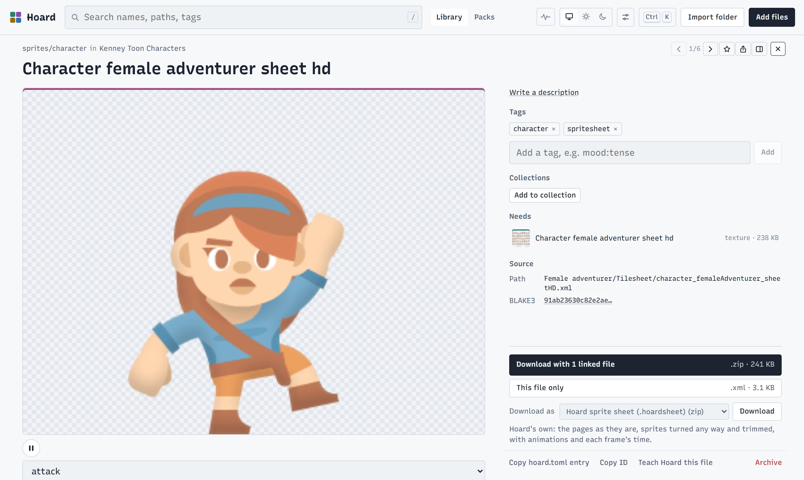

<div align="center">

# Hoard

[](https://github.com/Azazel-Labs/Hoard/actions/workflows/ci.yml)
[](https://github.com/Azazel-Labs/Hoard/releases/latest)
[](https://www.rust-lang.org)
[](../../LICENSE)

[English](../../README.md) · [Afrikaans](README.af.md) · [Català](README.ca.md) · [Čeština](README.cs.md) · [Dansk](README.da.md) · [Deutsch](README.de.md) · [Ελληνικά](README.el.md) · [Español (Latinoamérica)](README.es-419.md) · [Español (España)](README.es-ES.md) · [Suomi](README.fi.md) · [Français](README.fr.md) · Magyar · [Bahasa Indonesia](README.id.md) · [Italiano](README.it.md) · [日本語](README.ja.md) · [한국어](README.ko.md) · [Norsk bokmål](README.nb.md) · [Nederlands](README.nl.md) · [Polski](README.pl.md) · [Português (Brasil)](README.pt-BR.md) · [Português (Portugal)](README.pt-PT.md) · [Română](README.ro.md) · [Русский](README.ru.md) · [Српски](README.sr-Cyrl.md) · [Svenska](README.sv.md) · [ไทย](README.th.md) · [Türkçe](README.tr.md) · [Українська](README.uk.md) · [Tiếng Việt](README.vi.md) · [简体中文](README.zh-Hans.md) · [繁體中文](README.zh-Hant.md)

</div>

<h3 align="center">Minden assetcsomagja kereshető, előnézetben megnézhető, és egy kattintásnyira van a játékától.</h3>

A Hoard saját szerveren futó könyvtár játékassetekhez. Dobjon be egy zipet, egy Unity-csomagot, egy Fab-letöltést vagy
egy tízezer fájlt tartalmazó mappát, és a Hoard munkához lát. A modellek a textúráikkal együtt forognak 3D-ben, a
különálló textúratérképekből anyagok lesznek, a hangok kirajzolják a hullámformájukat, a spritelapok lejátsszák az
animációikat, és minden címkét kap, így a `footsteps gravel` vagy a `rigged low-poly` beírására előkerül. Aztán
mindazzal együtt érkezik a Godotba, a Unitybe vagy az Unrealbe, amire szüksége van.

Nincs előfizetés, nincs feltöltés senki felhőjébe, nincs felhasználónkénti díj: egyetlen Docker-image a saját szerverén,
vagy egy alkalmazás a saját számítógépén, és az az Öné. Olyan, mint egy assetáruház, csak pénztár nélkül.

<picture>
  <source media="(prefers-color-scheme: dark)" srcset="../img/hero-dark.webp">
  
</picture>

### Lásson mindent, mielőtt használja

A modellek 3D-ben nyílnak meg a textúráikkal, anyagaikkal és animációikkal. Az FBX, glTF, OBJ, USD, SketchUp, 3MF és STL
fájlokat, valamint a voxeleket maga a Hoard olvassa be, telepített 3D-alkalmazás nélkül; a Blender-fájlok felület nélkül
futó Blenderen keresztül érkeznek, az Unreal-csomagoknál pedig látszik, mit mentett róluk a szerkesztő, Unreal nélkül. A
bélyegképeket a szerver rajzolja, mindig ugyanúgy keretezve, így egy teljes csomagot egy pillantással át lehet futni.

<picture>
  <source media="(prefers-color-scheme: dark)" srcset="../img/page-dark.webp">
  
</picture>

### A különálló textúratérképekből anyagok lesznek

A `Rock_BaseColor.png`, a `Rock_Normal.png` és a `Rock_Roughness.png` egyetlen Rock anyaggá áll össze egy megvilágított
gömbön. A Hoard érti a Megascans, a Poly Haven, az ambientCG, a Substance és az Unreal elnevezési szokásait, az
összecsomagolt térképeket is beleértve, és a Unity `.mat` fájljait is beolvassa. A teljes képernyős nézegető gömbön,
kockán vagy síkon mutatja az anyagot, valós méretarányban, és minden térkép külön be- és kikapcsolható.

<picture>
  <source media="(prefers-color-scheme: dark)" srcset="../img/material-dark.webp">
  
</picture>

### Lejátszható spritelapok

A TexturePacker, a Starling, a libGDX, a Cocos2d és a Godot atlaszaiból egyetlen spritelap lesz, amely lejátssza az
animációit és felsorolja a spritejait. Töltse le újracsomagolva ahhoz a motorhoz, amelyet éppen használ: tíz formátum,
és mindegyik csak azt kapja meg, amit tárolni tud.

<picture>
  <source media="(prefers-color-scheme: dark)" srcset="../img/sheet-dark.webp">
  
</picture>

### Látható hangok

Minden hang kap egy hullámformát, amelynek színe attól függ, mennyire fényesen szól, így egy éles ütés és egy hosszú
atmoszféra már lejátszás előtt is másképp néz ki. A Hoard beolvassa a hangkönyvtárak metaadatait (UCS-kategóriák,
Soundminer- és BaseHead-mezők, looppontok, tempó, alaphang), a MIDI- és trackerzenét pedig lerendereli, így az is úgy
szól, mint bármely más hang.

<picture>
  <source media="(prefers-color-scheme: dark)" srcset="../img/sound-dark.webp">
  
</picture>

### Keresés, amely tudja, mi micsoda

A Hoard mindent maga címkéz fel, offline: `tileable`, `res:2k`, `poly:low`, `rigged`, `loop`, `bpm:120`, `license:cc0`,
valamint egy kategória egy játékasset-fából. Keressen szavakkal, színnel vagy azzal, ami egy képen látható, és kérjen
bármely textúrához vagy hanghoz „Több ilyen” találatot. Irányítsa bármely OpenAI-kompatibilis modellre, helyire vagy
felhőben futóra, és neveket meg leírásokat is ír.

<picture>
  <source media="(prefers-color-scheme: dark)" srcset="../img/search-dark.webp">
  
</picture>

### Egyenesen a játékmotorba

- **Motorbővítmények** a Godot 4-hez, a Unityhez, az Unreal Engine 5-höz és a Luminához: böngéssze a könyvtárat a szerkesztőn belül,
  és nyomja meg a Hozzáadás a projekthez gombot. A modell a textúráival együtt, a megfelelő helyre, importálva érkezik.
- A **`hoard sync`** pontosan azokat a fájlokat húzza be egy projektbe, amelyeket a projekt megnevez, egy lockfájlban
  rögzítve, így minden csapattag és buildgép ugyanazokat a bájtokat kapja.
- **Letöltés másként**: GLB, PNG, WAV, MP3 vagy spritelap-formátum, menet közben átalakítva, a textúrák neveit a
  stúdiója konvenciója szerint adva.
- **MI-ügynökök** keresnek, vizsgálnak meg és töltenek le asseteket MCP-n keresztül.

### Egyszer tárolva, biztonságban

Minden fájl egyszer tárolódik a BLAKE3-hash-e alapján, így ugyanaz a textúra öt csomagban is csak egynyi helyet foglal,
és a sérülés nem maradhat észrevétlen. Tárolhatja helyi lemezen vagy bármilyen S3-bucketben. Azokat a mappákat,
amelyekre a Hoardot ráirányítja, csak olvassa, sosem módosítja. Fiókok, csak olvasható tokenek, egyszeri bejelentkezés,
HTTPS és HTTP/3 beépítve.

### Vagy csak a saját számítógépén

Nem futtat szervert? A Windowsra, macOS-re és Linuxra készült asztali alkalmazás ugyanaz a könyvtár, a saját ablakában.
Telepítse, válasszon egy mappát, és internet nélkül is működik: nincsenek fiókok, jelszavak vagy szerverbeállítások, a
hálózat többi része semmit sem ér el belőle, a beírt kulcsokat pedig a rendszer jelszótárolója őrzi. Az új verziók a
háttérben töltődnek le, és kilépéskor települnek.

<picture>
  <source media="(prefers-color-scheme: dark)" srcset="../img/desktop-dark.webp">
  
</picture>

<sub>A bemutatókönyvtár CC0 grafikákból áll: modellek a [Poly Havenről](https://polyhaven.com) (glTF és USD), felületek
az [ambientCG-ről](https://ambientcg.com), hangok, spritelapok és betűtípusok pedig a [Kenneytől](https://kenney.nl). A
`node web/scripts/readme-images.mts` készíti ezeket a képeket és a közösségimédia-kártyát.</sub>

## Az asztali alkalmazás telepítése

Töltse le a [legújabb kiadásból](https://github.com/Azazel-Labs/Hoard/releases/latest): Windowsra a `-setup.exe`, Apple
chipes Macen futó macOS-re a `.dmg`, Linuxra az `.AppImage` vagy a `.deb` fájlt. Windowson csak az Ön számára települ,
és nem kér rendszergazdai jogosultságot. A telepítőket az Apple és a Microsoft még nem írta alá, ezért a Windows
rákérdez, mielőtt futtatná a telepítőt (További információ → Futtatás mindenképp), a macOS pedig az alkalmazás első
megnyitása előtt (System Settings → Privacy & Security → Open Anyway).

Első megnyitáskor megkérdezi, hová kerüljön a könyvtár. Minden más a Beállításokban van, ahogy a szerveren is.

Ezután magától naprakész marad, semmire sem kell kattintania: az új kiadás a háttérben letöltődik, és kilépéskor
települ, így amikor legközelebb megnyitja a Hoardot, már az új verzió indul el. A `.deb` csomagot a következő
telepítésével lehet frissíteni.

## Telepítés Dockerrel

A Hoard egyetlen képfájlként érhető el amd64-re és arm64-re: `ghcr.io/azazel-labs/hoard`. Mentse ezt `compose.yml`
néven (ez a [deploy/compose.yml](../../deploy/compose.yml)):

```yaml
services:
  hoard:
    container_name: hoard
    image: ghcr.io/azazel-labs/hoard:latest
    restart: unless-stopped
    volumes:
      - hoard-config:/config      # database, Settings, backups: small, back it up
      - hoard-library:/library    # your files: big, put it on the disk with room
      - hoard-cache:/cache        # thumbnails, uploads in progress, Blender/ffmpeg: fast disk, can be rebuilt
    ports:
      - "4627:4627"

volumes:
  hoard-config:
  hoard-library:
  hoard-cache:
```

Bármelyik kötet lehet helyette egy mappa azon a lemezen, amelyik illik hozzá: a `/mnt/big/hoard:/library` a nagy
lemezre teszi a fájljait, míg az adatbázis kicsi marad, és könnyen menthető. A csatolt mappákhoz nem kell chown: a
Hoard átveszi a `/config` és a `/cache` mappát, és a `/library` tulajdonosaként fut (a `PUID` és a `PGID` beállításával
maga is választhat felhasználót).

Ezután indítsa el:

```sh
docker compose up -d        # open http://<host>:4627
```

Az első látogatáskor létre kell hoznia egy fiókot, majd egy rövid beállítás következik, amely megkérdezi, hol legyen a könyvtára. A `/library` mappát javasolja, a fenti kötetet; válassza
ezt, és dobjon egy csomagot a portálra. További helyeket később adhat hozzá a **Beállítások → Tárolási helyek** oldalon:

- **A Hoard által kezelt könyvtár** másolatot kap arról, amit feltölt vagy importál. Mindegyiknél be van jelölve,
  milyen fájltípusokat fogad (a hangokat az egyik lemezre, a modelleket a másikra), és egy közülük a gyűjtőhely a
  többinek. Ha módosítja, mit fogad egy hely, az az új fájlokra vonatkozik; a **Tárolt fájlok áthelyezése** a már
  tároltakat is áthelyezi. Az **Eltávolítás** előbb típus szerint átviszi a hely fájljait a többire, és akkor
  távolítja el, amikor kiürült. A régi másolat törlése előtt minden fájl ellenőrződik a hash-e alapján. Az a hely,
  amelynek a lemeze eltűnt, így is eltávolítható, és a fájljai ezután hiányzóként jelennek meg.
- **A figyelt mappa** egy meglévő csomagokat tartalmazó mappa. A benne lévő minden mappa egy csomag lesz, amelyet a
  Hoard a helyén indexel. A Hoard soha semmit nem módosít, helyez át vagy töröl benne. Csatolhatja csak olvashatóként
  is. A Hoard indításkor, majd 15 percenként (vagy amikor a **Vizsgálat most** gombra kattint) átnézi, és észreveszi
  az új mappákat, a csomagokhoz hozzáadott vagy belőlük eltávolított fájlokat, valamint azokat a csomagokat, amelyek
  mappája eltűnt. Egy hirtelen üressé vagy elérhetetlenné vált mappát nem csatolt lemeznek tekint, és megtartja a
  csomagjait. Azt a csomagot, amelynek mappája hiányzik, három napig megtartja a címkéivel és jegyzeteivel együtt,
  arra az esetre, ha a mappa visszakerülne. Amit egy figyelt csomagból véglegesen töröl, az a mappa újravizsgálatakor
  is törölve marad, pedig a fájljai még ott vannak.

Hely bármely mappa lehet, amelyet a szerver lát, ezért Dockerben előbb csatolja a konténerbe.

**Frissítés.** A fejléc jelvényt mutat, ha újabb kiadás érhető el. A frissítéshez futtassa a
`docker compose pull && docker compose up -d` parancsot; a Hoard induláskor frissíti az adatbázisát, és előtte
másolatot ment róla a `/config/backups` mappába. Ha csak javítókiadásokat szeretne, változtassa a képcímkét `:1.3`
értékre. Ha automatikusan szeretne frissíteni anélkül, hogy a Hoard feltöltés közben újraindulna, adjon meg egy
meghívandó címet a **Beállítások → Karbantartás → Frissítések** alatt: a Hoard akkor hívja meg, amikor megjelent egy
kiadás, és semmi sincs folyamatban (a Watchtower HTTP API-ja, egy Portainer-webhook, egy szkript; lásd:
[docs/DEPLOYMENT.md](../DEPLOYMENT.md#updating)).

**GPU (nem kötelező).** A Hoard a GPU-n rendereli a 3D-modellek bélyegképeit, ha lát egyet, és szoftveresen, ha nem.
A csomagok oldala megmutatja, melyik történik (`GPU: ...` vagy `No GPU found`). A GPU átadásához adja hozzá a
hardverének megfelelő kiegészítő compose-fájlt:

```sh
# NVIDIA: needs the NVIDIA driver and the NVIDIA Container Toolkit on the host
docker compose -f compose.yml -f compose.gpu-nvidia.yml up -d

# Intel or AMD, including integrated graphics: needs /dev/dri on the host
echo "RENDER_GID=$(getent group render | cut -d: -f3)" >> .env
docker compose -f compose.yml -f compose.gpu-dri.yml up -d
```

Mindkét kiegészítő fájl megtalálható itt: [deploy/](../../deploy/). Ezek a helyi modellszervert (MI-címkézés) is a GPU-ra teszik. A NAS-on tárolt fájlokról, az S3-tárolásról, a Cloudflare-en
vagy Tailscale-en keresztüli távoli elérésről és a biztonsági mentésekről a [docs/DEPLOYMENT.md](../DEPLOYMENT.md) szól.

## Fordítás forrásból

```sh
# Server (stable Rust via rust-toolchain.toml, MSRV 1.100; rustup installs it automatically)
cargo build --release
(cd web && npm ci && npm run build)
./target/release/hoardd                      # http://127.0.0.1:4627

# Try it with a generated sample pack (textures, PBR set, sprites, audio, glTF/OBJ/GLB models, CC0 license)
python3 tools/make_sample_pack.py /tmp/sample       # needs Pillow + numpy; ffmpeg optional
./target/release/hoard --token <token> upload /tmp/sample/forest-starter-kit.zip   # make the token in Settings → Account
```

Vagy dobja a zipet a portálra.

## A README többi része

Hogy mi történik egy csomaggal, hogyan kerülnek az assetek egy játékmotorba, valamint az Unreal-csomagok, a keresés,
a forrásmegjelölés, az MCP, a tárolás, a HTTPS, a konfiguráció, a biztonság, a fiókok, az API,
továbbá a tények és számok leírása az [angol README-ben](../../README.md) található.

## Fordítások

A Hoard portálja és szerverüzenetei 31 nyelven érhetők el, a nyelv a Beállítások → Megjelenés alatt választható
(alapértelmezés szerint a böngésző nyelve). Az első fordítások gépi segítséggel készültek; az anyanyelvi beszélők
javításait szívesen fogadjuk. Hogy hogyan, azt a [docs/translations.md](../translations.md) írja le.

## Licenc

[MIT No Attribution](../../LICENSE) (MIT-0): a Hoard bármilyen célra használható, másolható, módosítható és
továbbterjeszthető, a szerzői jogi megjegyzés megtartása nélkül is. A Hoardban tárolt assetcsomagokra a saját
licencük vonatkozik.
