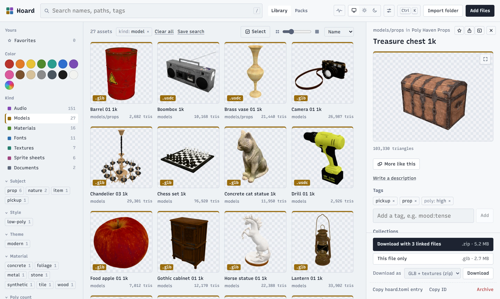

# Hoard

[](https://github.com/Azazel-Labs/Hoard/actions/workflows/ci.yml)
[](https://github.com/Azazel-Labs/Hoard/releases/latest)
[](https://www.rust-lang.org)
[](../../LICENSE)

[English](../../README.md) · [Afrikaans](README.af.md) · [Català](README.ca.md) · [Čeština](README.cs.md) · [Dansk](README.da.md) · [Deutsch](README.de.md) · [Ελληνικά](README.el.md) · [Español (Latinoamérica)](README.es-419.md) · [Español (España)](README.es-ES.md) · [Suomi](README.fi.md) · [Français](README.fr.md) · [Magyar](README.hu.md) · [Bahasa Indonesia](README.id.md) · [Italiano](README.it.md) · [日本語](README.ja.md) · [한국어](README.ko.md) · [Norsk bokmål](README.nb.md) · [Nederlands](README.nl.md) · [Polski](README.pl.md) · [Português (Brasil)](README.pt-BR.md) · [Português (Portugal)](README.pt-PT.md) · [Română](README.ro.md) · Русский · [Српски](README.sr-Cyrl.md) · [Svenska](README.sv.md) · [ไทย](README.th.md) · [Türkçe](README.tr.md) · [Українська](README.uk.md) · [Tiếng Việt](README.vi.md) · [简体中文](README.zh-Hans.md) · [繁體中文](README.zh-Hant.md)

Самостоятельно размещаемая библиотека ассетов для разработки игр. Закиньте в неё целые паки ассетов (zip, tar-архивы,
папки), и Hoard сохранит каждый файл один раз по его хешу, определит, что это за файл, расставит теги, свяжет меши с
их текстурами и анимациями и сделает всё это доступным для поиска через веб-портал, CLI, MCP-эндпоинт для агентов и
команду `hoard sync` на основе lock-файла, которая забирает ровно те файлы, что нужны вашему игровому проекту.

Это как магазин ассетов, только без кассы.

<picture>
  <source media="(prefers-color-scheme: dark)" srcset="../img/hero-dark.webp">
  
</picture>

<sub>Демонстрационная библиотека состоит из работ под CC0: модели с [Poly Haven](https://polyhaven.com) (glTF и USD) и
поверхности с [ambientCG](https://ambientcg.com). `node web/scripts/readme-images.mts` создаёт эти картинки и
карточку для соцсетей.</sub>

## Установка через Docker

Hoard поставляется одним образом для amd64 и arm64: `ghcr.io/azazel-labs/hoard`. Сохраните это как `compose.yml`
(это [deploy/compose.yml](../../deploy/compose.yml)):

```yaml
services:
  hoard:
    container_name: hoard
    image: ghcr.io/azazel-labs/hoard:latest
    restart: unless-stopped
    volumes:
      - hoard-config:/config      # database, Settings, backups: small, back it up
      - hoard-library:/library    # your files: big, put it on the disk with room
      - hoard-cache:/cache        # thumbnails, uploads in progress, Blender/ffmpeg: fast disk, can be rebuilt
    ports:
      - "4627:4627"

volumes:
  hoard-config:
  hoard-library:
  hoard-cache:
```

Вместо тома каждый из них может быть папкой на подходящем диске: `/mnt/big/hoard:/library` кладёт ваши файлы на
большой диск, а база данных остаётся маленькой, и её легко резервировать. Подключаемым папкам не нужен chown: Hoard
берёт на себя `/config` и `/cache` и работает от имени владельца `/library` (задайте `PUID` и `PGID`, чтобы выбрать
пользователя самостоятельно).

Затем запустите его:

```sh
docker compose up -d        # open http://<host>:4627
```

При первом визите вас попросят создать учётную запись, а затем откроется короткая настройка, которая спросит, где будет храниться библиотека. Она предложит `/library` — том выше; выберите
его и перетащите пак на портал. Другие места хранения можно добавить позже в **«Настройки → Места хранения»**:

- **Библиотека, которую хранит Hoard**, получает копии того, что вы загружаете или импортируете. В каждой отмечены
  виды файлов, которые она берёт (аудио на одном диске, модели на другом), и одна из них — место для всего остального.
  Изменение того, что берёт место хранения, касается новых файлов; **«Перенести сохранённые файлы»** переносит уже
  сохранённое. **«Удалить»** сначала переносит файлы места хранения в остальные, по видам, и удаляет его, когда оно
  опустеет. Перед удалением старой копии каждый файл сверяется со своим хешем. Место хранения, диск которого пропал,
  всё равно можно удалить, и тогда его файлы будут показаны как отсутствующие.
- **Отслеживаемая папка** — это папка с уже имеющимися у вас паками. Каждая папка внутри неё становится паком и
  индексируется там, где лежит. Hoard никогда ничего в ней не меняет, не перемещает и не удаляет. Если хотите,
  подключите её только для чтения. Hoard просматривает её при запуске и затем каждые 15 минут (или когда вы нажимаете
  **«Сканировать»**), подхватывая новые папки, файлы, добавленные в пак или удалённые из него, и паки, папка которых
  пропала. Папка, которая вдруг стала пустой или недоступной, считается диском, который не подключён, и её паки
  сохраняются. Пак, папка которого пропала, хранится три дня вместе с тегами и заметками на случай, если папка
  вернётся. То, что вы навсегда удалили из отслеживаемого пака, остаётся удалённым при повторном сканировании папки,
  хотя его файлы по-прежнему там.

Место хранения — это любая папка, которую видит сервер, поэтому в Docker сначала подключите её в контейнер.

**Обновление.** Когда выходит новый выпуск, в заголовке появляется значок. Выполните
`docker compose pull && docker compose up -d`, чтобы его установить; при запуске Hoard обновляет свою базу данных,
сначала сохранив копию в `/config/backups`. Измените тег образа на `:0.8`, чтобы получать только патч-выпуски. Чтобы
обновляться автоматически, не перезапуская Hoard посреди загрузки, укажите в **«Настройки → Обслуживание →
Обновления»** адрес для вызова: Hoard вызовет его, когда выпуск выйдет и ничего не будет происходить (HTTP API
Watchtower, вебхук Portainer, скрипт; см. [docs/DEPLOYMENT.md](../DEPLOYMENT.md#updating)).

**GPU (необязательно).** Hoard рендерит миниатюры 3D-моделей на GPU, если видит его, а если нет — программно.
Страница паков показывает, как именно (`GPU: ...` или `No GPU found`). Чтобы пробросить GPU, добавьте оверлей для
своего оборудования:

```sh
# NVIDIA: needs the NVIDIA driver and the NVIDIA Container Toolkit on the host
docker compose -f compose.yml -f compose.gpu-nvidia.yml up -d

# Intel or AMD, including integrated graphics: needs /dev/dri on the host
echo "RENDER_GID=$(getent group render | cut -d: -f3)" >> .env
docker compose -f compose.yml -f compose.gpu-dri.yml up -d
```

Оба оверлея лежат в [deploy/](../../deploy/). Они также переносят на GPU локальный сервер моделей (теги от ИИ). Файлы на NAS, хранилище S3, удалённый доступ через Cloudflare
или Tailscale и резервное копирование описаны в [docs/DEPLOYMENT.md](../DEPLOYMENT.md).

## Сборка из исходников

```sh
# Server (Rust 1.99.1 is pinned in rust-toolchain.toml; rustup installs it automatically)
cargo build --release
(cd web && npm ci && npm run build)
./target/release/hoardd                      # http://127.0.0.1:4627

# Try it with a generated sample pack (textures, PBR set, sprites, audio, glTF/OBJ/GLB models, CC0 license)
python3 tools/make_sample_pack.py /tmp/sample       # needs Pillow + numpy; ffmpeg optional
./target/release/hoard --token <token> upload /tmp/sample/forest-starter-kit.zip   # make the token in Settings → Account
```

Или перетащите zip на портал.

## Остальная часть этого README

Что происходит с паком, как перенести ассеты в движок, паки Unreal, поиск, авторы, MCP, хранение, HTTPS, настройка,
безопасность, учётные записи и API описаны в [README на английском](../../README.md).

## Переводы

Сообщения портала и сервера Hoard доступны на 31 языке; язык выбирается в «Настройки → Оформление» (по умолчанию —
язык браузера). Первые переводы были сделаны с помощью машинного перевода; исправления от носителей языка
приветствуются. Как это сделать, объясняет [docs/translations.md](../translations.md).

## Лицензия

[MIT No Attribution](../../LICENSE) (MIT-0): используйте, копируйте, изменяйте и распространяйте Hoard для любых
целей, без необходимости сохранять уведомление об авторских правах. Паки ассетов, которые вы храните в Hoard,
сохраняют собственные лицензии.
