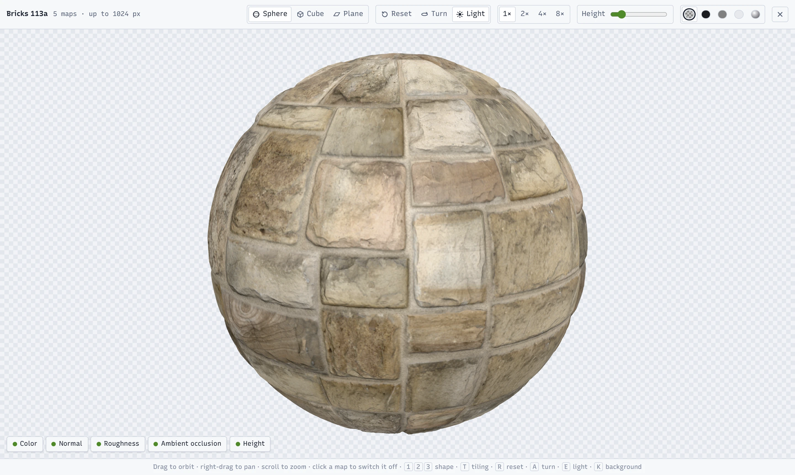
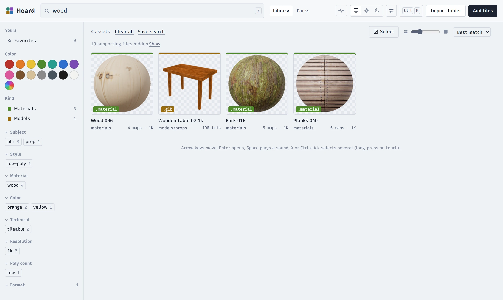

<div align="center">

# Hoard

[](https://github.com/Azazel-Labs/Hoard/actions/workflows/ci.yml)
[](https://github.com/Azazel-Labs/Hoard/releases/latest)
[](https://www.rust-lang.org)
[](../../LICENSE)

[English](../../README.md) · [Afrikaans](README.af.md) · [Català](README.ca.md) · [Čeština](README.cs.md) · [Dansk](README.da.md) · [Deutsch](README.de.md) · [Ελληνικά](README.el.md) · [Español (Latinoamérica)](README.es-419.md) · [Español (España)](README.es-ES.md) · [Suomi](README.fi.md) · [Français](README.fr.md) · [Magyar](README.hu.md) · [Bahasa Indonesia](README.id.md) · [Italiano](README.it.md) · [日本語](README.ja.md) · [한국어](README.ko.md) · [Norsk bokmål](README.nb.md) · [Nederlands](README.nl.md) · [Polski](README.pl.md) · [Português (Brasil)](README.pt-BR.md) · [Português (Portugal)](README.pt-PT.md) · [Română](README.ro.md) · [Русский](README.ru.md) · [Српски](README.sr-Cyrl.md) · [Svenska](README.sv.md) · [ไทย](README.th.md) · Türkçe · [Українська](README.uk.md) · [Tiếng Việt](README.vi.md) · [简体中文](README.zh-Hans.md) · [繁體中文](README.zh-Hant.md)

</div>

<h3 align="center">Sahip olduğunuz her varlık paketi: aranabilir, önizlenebilir ve oyununuza bir tık uzaklıkta.</h3>

Hoard, oyun varlıkları için kendi sunucunuzda barındırdığınız bir kütüphanedir. Bir zip, bir Unity paketi, bir Fab
indirmesi ya da on bin dosyalık bir klasör bırakın, Hoard hemen işe koyulur. Modeller dokularıyla birlikte 3B olarak
döner, dağınık doku haritaları malzemeye dönüşür, sesler dalga biçimlerini çizer, sprite sayfaları animasyonlarını
oynatır ve her şey etiketlenir; böylece `footsteps gravel` ya da `rigged low-poly` yazmanız onu bulmaya yeter. Ardından
ihtiyaç duyduğu her şeyle birlikte Godot, Unity ya da Unreal projenize iner.

Abonelik yok, kimsenin bulutuna yükleme yok, kullanıcı başına ücret yok: kendi sunucunuzda tek bir Docker imajı ya da
kendi bilgisayarınızda bir uygulama ve tamamen sizin. Onu ödeme adımı olmayan bir varlık mağazası gibi düşünün.

<picture>
  <source media="(prefers-color-scheme: dark)" srcset="../img/hero-dark.webp">
  
</picture>

### Kullanmadan önce her şeyi görün

Modeller dokuları, malzemeleri ve animasyonlarıyla birlikte 3B olarak açılır. FBX, glTF, OBJ, USD, SketchUp, 3MF, STL ve
voksel dosyalarını, hiçbir 3B uygulaması kurulu olmadan Hoard’un kendisi okur; Blender dosyaları arayüzsüz (headless)
Blender aracılığıyla gelir, Unreal paketleri ise Unreal olmadan, düzenleyicinin onlar hakkında kaydettiklerini gösterir.
Küçük resimler sunucuda, her seferinde aynı şekilde çerçevelenerek çizilir; böylece bir paketin tamamına bir bakışta göz
gezdirilebilir.

<picture>
  <source media="(prefers-color-scheme: dark)" srcset="../img/page-dark.webp">
  
</picture>

### Dağınık doku haritaları malzemeye dönüşür

`Rock_BaseColor.png`, `Rock_Normal.png` ve `Rock_Roughness.png`, ışıklandırılmış bir küre üzerinde tek bir Rock
malzemesi olur. Hoard, paketlenmiş haritalar dahil Megascans, Poly Haven, ambientCG, Substance ve Unreal
adlandırmalarını, ayrıca Unity `.mat` dosyalarını da okur. Tam ekran görüntüleyici bir malzemeyi küre, küp ya da düzlem
üzerinde, gerçek dünya ölçeğinde gösterir; her harita ayrı ayrı açılıp kapatılabilir.

<picture>
  <source media="(prefers-color-scheme: dark)" srcset="../img/material-dark.webp">
  
</picture>

### Oynayan sprite sayfaları

TexturePacker, Starling, libGDX, Cocos2d ve Godot atlasları, animasyonlarını oynatan ve sprite’larını listeleyen tek bir
sprite sayfası olur. Hangi motoru kullanıyorsanız onun için yeniden paketlenmiş olarak indirin: on biçim, her birine
yalnızca taşıyabildiği bilgiler verilir.

<picture>
  <source media="(prefers-color-scheme: dark)" srcset="../img/sheet-dark.webp">
  
</picture>

### Görebileceğiniz sesler

Her ses, kulağa ne kadar parlak geldiğine göre renklendirilmiş bir dalga biçimi alır; böylece keskin bir vuruş ile uzun
bir ortam sesi, siz onları çalmadan önce farklı görünür. Ses kütüphanesi meta verileri okunur (UCS kategorileri,
Soundminer ve BaseHead alanları, döngü noktaları, tempo, kök nota); MIDI ve tracker müziği de diğer her ses gibi
çalınabilmesi için sese dönüştürülür.

<picture>
  <source media="(prefers-color-scheme: dark)" srcset="../img/sound-dark.webp">
  
</picture>

### Neyin ne olduğunu bilen arama

Hoard her şeyi kendisi, çevrimdışı olarak etiketler: `tileable`, `res:2k`, `poly:low`, `rigged`, `loop`, `bpm:120`,
`license:cc0` ve oyun varlıklarına özgü bir ağaçtan bir kategori. Kelimelerle, renge göre ya da bir resmin ne
gösterdiğine göre arayın ve herhangi bir doku ya da sesten “Buna benzerler”i isteyin. Hoard’u yerel ya da barındırılan,
OpenAI uyumlu herhangi bir modele yönlendirin; adları ve açıklamaları da o yazsın.

<picture>
  <source media="(prefers-color-scheme: dark)" srcset="../img/search-dark.webp">
  
</picture>

### Doğrudan motorunuza

- **Motor eklentileri** Godot 4, Unity, Unreal Engine 5 ve Lumina için: kütüphaneye düzenleyicinin içinden göz atın ve Projeye
  ekle’ye basın. Model, dokularıyla birlikte, doğru yere ve içe aktarılmış olarak gelir.
- **`hoard sync`**, bir projenin adını verdiği dosyaları tam olarak projeye çeker ve bir kilit dosyasına sabitler;
  böylece her ekip arkadaşı ve derleme makinesi aynı baytları alır.
- **Farklı indir**: GLB, PNG, WAV, MP3 ya da bir sprite sayfası biçimi; anında dönüştürülür, doku adları stüdyonuzun
  adlandırma kuralına uyar.
- **Yapay zekâ ajanları** MCP üzerinden varlıkları arar, inceler ve getirir.

### Bir kez saklanır, güvende tutulur

Her dosya BLAKE3 karmasına göre bir kez saklanır; böylece beş pakette bulunan aynı doku tek bir dokunun yerini kaplar ve
bozulma fark edilmeden kalamaz. Kütüphaneyi yerel diskte ya da herhangi bir S3 kovasında tutun. Hoard’u yönlendirdiğiniz
klasörler okunur, asla değiştirilmez. Hesaplar, salt okunur erişim belirteçleri, tek oturum açma (SSO), HTTPS ve HTTP/3
yerleşik olarak gelir.

### Ya da yalnızca bilgisayarınızda

Sunucu çalıştırmıyor musunuz? Windows, macOS ve Linux için masaüstü uygulaması, kendi penceresinde aynı kütüphanedir.
Kurup bir klasör seçtiğinizde çevrimdışı çalışır: hesap, parola ya da sunucu ayarı yok, ağın geri kalanının
erişebileceği hiçbir şey yok ve girdiğiniz anahtarlar sistemin anahtar zincirinde saklanır. Yeni sürümler arka planda
iner ve uygulamadan çıktığınızda kurulur.

<picture>
  <source media="(prefers-color-scheme: dark)" srcset="../img/desktop-dark.webp">
  
</picture>

<sub>Tanıtım kütüphanesi CC0 çizimlerden oluşur: [Poly Haven](https://polyhaven.com)’den modeller (glTF ve USD),
[ambientCG](https://ambientcg.com)’den yüzeyler ve [Kenney](https://kenney.nl)’den sesler, sprite sayfaları ve yazı
tipleri. Bu resimleri ve sosyal medya kartını `node web/scripts/readme-images.mts` oluşturur.</sub>

## Masaüstü uygulamasının kurulumu

Uygulamayı [en son sürümden](https://github.com/Azazel-Labs/Hoard/releases/latest) indirin: Windows için `-setup.exe`,
Apple silicon’lı macOS için `.dmg`, Linux için `.AppImage` ya da `.deb`. Windows’ta yalnızca sizin için kurulur ve
yönetici izni istemez. Kurulum dosyaları henüz Apple ya da Microsoft tarafından imzalanmadığı için Windows kurulum
dosyasını çalıştırmadan önce (Ek bilgi → Yine de çalıştır), macOS ise uygulamayı ilk kez açmadan önce (Sistem Ayarları →
Gizlilik ve Güvenlik → Yine de Aç) sorar.

İlk açıldığında kütüphanenin nereye konacağını sorar. Geri kalan her şey, sunucuda olduğu gibi Ayarlar’dadır.

Sonrasında hiçbir şeye tıklamanıza gerek kalmadan kendini güncel tutar: yeni sürüm arka planda indirilir ve uygulamadan
çıktığınızda kurulur, böylece Hoard’u bir sonraki açışınızda yeni sürüm karşınızda olur. `.deb` paketi ise bir sonrakini
kurarak güncellenir.

## Docker ile kurulum

Hoard, amd64 ve arm64 için tek bir imaj olarak gelir: `ghcr.io/azazel-labs/hoard`. Bunu `compose.yml` olarak kaydedin
(bu dosya [deploy/compose.yml](../../deploy/compose.yml)):

```yaml
services:
  hoard:
    container_name: hoard
    image: ghcr.io/azazel-labs/hoard:latest
    restart: unless-stopped
    volumes:
      - hoard-config:/config      # database, Settings, backups: small, back it up
      - hoard-library:/library    # your files: big, put it on the disk with room
      - hoard-cache:/cache        # thumbnails, uploads in progress, Blender/ffmpeg: fast disk, can be rebuilt
    ports:
      - "4627:4627"

volumes:
  hoard-config:
  hoard-library:
  hoard-cache:
```

Her birim bunun yerine kendisine uygun diskteki bir klasör olabilir: `/mnt/big/hoard:/library` dosyalarınızı büyük
diske koyar, veritabanı ise küçük ve yedeklemesi kolay kalır. Bağladığınız klasörler chown gerektirmez: Hoard
`/config` ve `/cache` klasörlerini sahiplenir ve `/library` kimin sahipliğindeyse onun olarak çalışır (bir kullanıcıyı
kendiniz seçmek için `PUID` ve `PGID` ayarlayın).

Ardından başlatın:

```sh
docker compose up -d        # open http://<host>:4627
```

İlk ziyaret sizden bir hesap oluşturmanızı ister, ardından kütüphanenizin nerede duracağını soran kısa bir kurulum açar. Yukarıdaki birim olan `/library` klasörünü önerir;
onu seçin ve portala bir paket bırakın. Daha fazla konum daha sonra **Ayarlar → Kütüphane konumları** bölümünden eklenir:

- **Hoard’un tuttuğu bir kütüphane**, yüklediğiniz ya da içe aktardığınız şeylerin kopyalarını alır. Her biri aldığı
  dosya türlerini işaretler (bir diskte ses, başka birinde modeller) ve biri geri kalanlar için genel konumdur. Bir
  konumun aldığı türleri değiştirmek yeni dosyalara uygulanır; **Saklanan dosyaları buna göre taşı** zaten saklananları
  taşır. **Kaldır**, bir konumun dosyalarını önce türlerine göre diğerlerine taşır ve konum boşalınca onu kaldırır. Eski
  kopya silinmeden önce her dosya karmasına göre denetlenir. Diski artık olmayan bir konum yine de kaldırılabilir; o
  zaman dosyaları kayıp olarak görünür.
- **İzlenen bir klasör**, zaten sahip olduğunuz bir paket klasörüdür. İçindeki her klasör, bulunduğu yerde dizinlenen
  bir paket olur. Hoard oradaki hiçbir şeyi asla değiştirmez, taşımaz ya da silmez. İsterseniz onu salt okunur bağlayın.
  Hoard başlangıçta ve sonra her 15 dakikada bir (ya da **Şimdi tara**’ya bastığınızda) ona bakar; yeni klasörleri, bir
  pakete eklenen ya da paketten kaldırılan dosyaları ve klasörü kaybolan paketleri algılar. Birden boşalan ya da
  erişilemeyen bir klasör bağlanmamış bir disk sayılır ve paketleri tutulur. Klasörü kayıp olan bir paket, klasör geri
  gelir diye etiketleri ve notlarıyla birlikte üç gün tutulur. İzlenen bir paketten kalıcı olarak sildiğiniz her şey,
  dosyaları hâlâ orada olsa bile, klasör yeniden tarandığında silinmiş olarak kalır.

Konum, sunucunun görebildiği herhangi bir klasördür; bu yüzden Docker’da onu önce konteynere bağlayın.

**Güncelleme.** Daha yeni bir sürüm olduğunda üst çubukta bir rozet görünür. Almak için `docker compose pull && docker compose up -d`
komutunu çalıştırın; Hoard başlarken veritabanını yükseltir, önce bir kopyasını `/config/backups` içine kaydeder. Yalnızca
yama sürümlerini almak için imaj etiketini `:1.3` olarak değiştirin. Hoard’u bir yüklemenin ortasında yeniden başlatmadan
otomatik olarak güncellemek için **Ayarlar → Bakım → Güncellemeler** bölümüne çağrılacak bir adres verin: bir sürüm
çıktığında ve hiçbir şey yapılmıyorken Hoard o adresi çağırır (Watchtower’ın HTTP API’si, bir Portainer webhook’u, bir
betik; bkz. [docs/DEPLOYMENT.md](../DEPLOYMENT.md#updating)).

**GPU (isteğe bağlı).** Hoard, bir GPU görebildiğinde 3B model küçük resimlerini GPU’da, göremediğinde yazılımla çizer.
Paketler sayfası hangisi olduğunu gösterir (`GPU: ...` ya da `No GPU found`). GPU’yu konteynere geçirmek için
donanımınıza uygun ek dosyayı ekleyin:

```sh
# NVIDIA: needs the NVIDIA driver and the NVIDIA Container Toolkit on the host
docker compose -f compose.yml -f compose.gpu-nvidia.yml up -d

# Intel or AMD, including integrated graphics: needs /dev/dri on the host
echo "RENDER_GID=$(getent group render | cut -d: -f3)" >> .env
docker compose -f compose.yml -f compose.gpu-dri.yml up -d
```

Her iki ek dosyayı [deploy/](../../deploy/) klasöründen alın. Bunlar yerel model sunucusunu (yapay zekâ etiketleme) da GPU’ya taşır. NAS üzerindeki dosyalar, S3 depolama, Cloudflare
ya da Tailscale üzerinden uzaktan erişim ve yedeklemeler [docs/DEPLOYMENT.md](../DEPLOYMENT.md) içinde anlatılır.

## Kaynaktan derleme

```sh
# Server (stable Rust via rust-toolchain.toml, MSRV 1.100; rustup installs it automatically)
cargo build --release
(cd web && npm ci && npm run build)
./target/release/hoardd                      # http://127.0.0.1:4627

# Try it with a generated sample pack (textures, PBR set, sprites, audio, glTF/OBJ/GLB models, CC0 license)
python3 tools/make_sample_pack.py /tmp/sample       # needs Pillow + numpy; ffmpeg optional
./target/release/hoard --token <token> upload /tmp/sample/forest-starter-kit.zip   # make the token in Settings → Account
```

Ya da zip’i portala bırakın.

## Bu README’nin geri kalanı

Bir pakete ne olduğu, varlıkları bir motora aktarma, Unreal paketleri, arama, emeği geçenler, MCP, depolama, HTTPS,
yapılandırma, güvenlik, hesaplar, API, temel bilgiler ve rakamlar [İngilizce README](../../README.md)’de anlatılır.

## Çeviriler

Hoard’un portalı ve sunucu iletileri 31 dilde gelir; dil Ayarlar → Görünüm bölümünden seçilir (varsayılan olarak
tarayıcının dili). İlk çeviriler makine desteğiyle yapıldı; ana dili konuşanlardan gelen düzeltmeler memnuniyetle karşılanır. Nasıl yapılacağını [docs/translations.md](../translations.md) anlatır.

## Lisans

[MIT No Attribution](../../LICENSE) (MIT-0): Hoard’u herhangi bir amaçla kullanın, kopyalayın, değiştirin ve yeniden
dağıtın; telif hakkı bildirimini korumanız gerekmez. Hoard’da sakladığınız varlık paketleri kendi lisanslarını korur.
